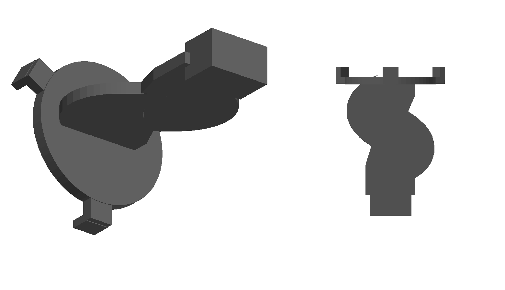
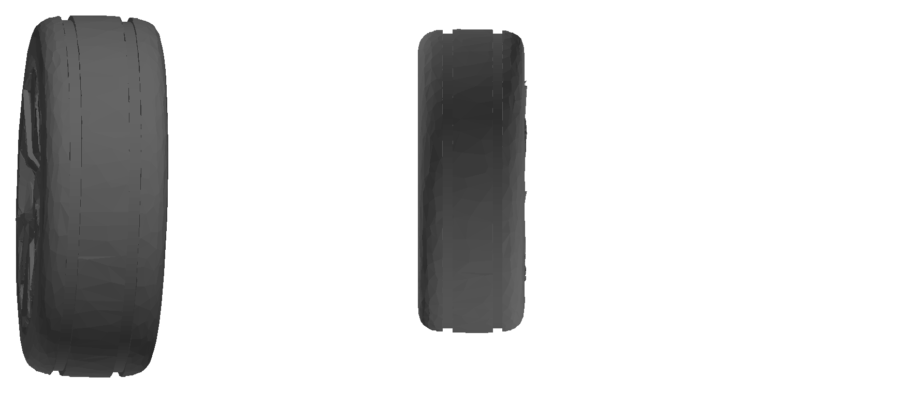
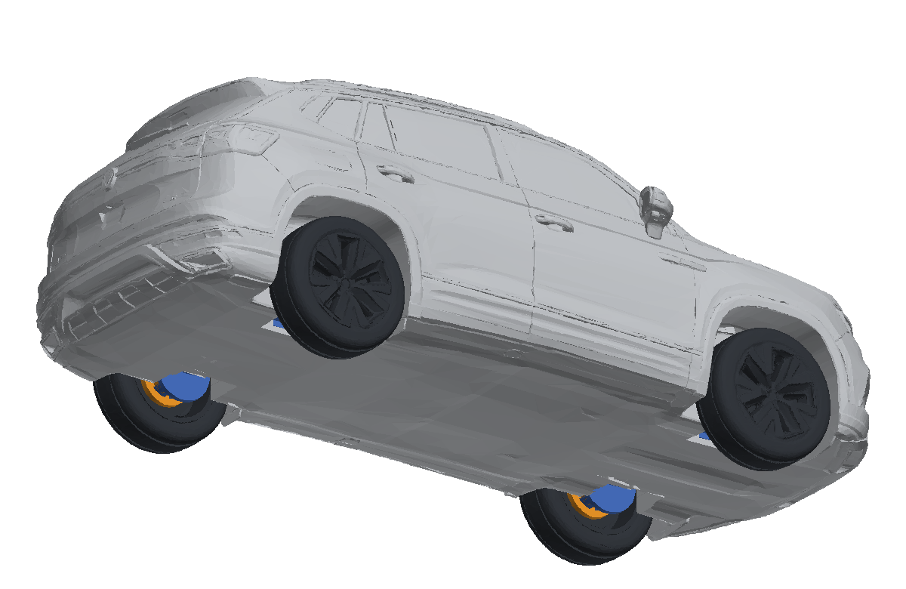

# VW Tayron — модель с подвеской под печать на PLA

Кузов Tayron + подвеска на 4 колеса, целиком печатаемая на FDM из PLA.
**Пружин и шарниров нет:** каждое колесо держится на **S-образном упругом
переходнике** — при взгляде сверху он читается как буква S, а амортизация
идёт за счёт изгиба его тонкой ленты.

**Колёса — исходные, без единого реза.** В дисках нет ни одного отверстия:
в *родной* паз ступицы вклеивается печатная **втулка колеса** (фланец Ø9.6
лежит на плоском дне паза), а звено садится на её бобышку Ø6 с натягом.
Снаружи диск выглядит ровно как в исходной модели. ТЗ, по которому это сделано (и по которому можно
повторить), лежит в [`DESIGN.md`](DESIGN.md).









## Что в репозитории

| Файл | Что это |
|---|---|
| `Tayron5_flex.3mf` | Печатная сборка, **13 объектов**: кузов с каналами + 4 S-переходника + 4 втулки + 4 колеса |
| `run.py` | Запуск сайта: сам находит свободный порт и открывает страницу |
| `suspension/` | Сайт с интерактивной демонстрацией (нагрузка в граммах, ход в мм, сборка/разборка) |
| `DESIGN.md` | ТЗ/промпт: ограничения PLA, формулы, критерии приёмки |
| `Модель №2 Tayron.3mf` | Исходная модель (кузов + колёса) |
| `Single_color.3mf` | Исходный проект пользователя (детали 217, 224 и др.) |
| `reference/` | Фотографии машины |

## Печать в 150 мм (в слайсере 17 %)

Файл остаётся в исходных единицах (кузов 882 ед.), печатать **уменьшенным
до 150 мм по длине** — в слайсере 17 %. Все размеры механизма подобраны под
этот масштаб, в правой колонке — то, что получится на столе:

| Деталь | В файле | Напечатается |
|---|---|---|
| S-переходник — лента | 35.3 × 5.3 ед. | **6.0 мм ширина × 0.9 мм толщина**, длина по кривой 18.3 мм |
| S-переходник — корневая колодка | 29.4 × 14.7 × 17.6 ед. | **5.0 × 2.5 × 3.0 мм** |
| S-переходник — опорная шайба | Ø64.7 × 5.3 ед. | **Ø11.0 × 0.9 мм** |
| S-переходник — стакан | Ø41.8 × 23.2 ед. | **Ø7.1 × 3.95 мм**, расточка **Ø5.9 × 3.55 мм**, 3 прорези по 1 мм через 120° |
| Втулка колеса — фланец | Ø56.5 × 5.9 ед. | **Ø9.6 × 1.0 мм** (клей в паз ступицы) |
| Втулка колеса — бобышка | Ø35.3 × 17.6 ед. | **Ø6.0 × 3.0 мм** под стакан звена |
| Канал под колодку в кузове | 6.2 × 3.7 × 3.6 мм | **зазор 0.6 мм** по бокам, 0.35 мм по глубине |
| Ход подвески | — | **1.4 мм** до отбойника |
| Протектор | канавка 0.8 мм | **2 кольцевые канавки 0.8 мм шириной, 0.4 мм глубиной**, на ±2 мм от средней плоскости колеса |
| Масса модели | — | ≈370 г при 100 % заполнении, ≈100 г при 20 % |

Что важно знать про этот масштаб:

* **Диски не сверлятся и не режутся.** Втулка входит в *родной* паз с
  внутренней стороны ступицы: фланец Ø9.6 целиком лежит на плоском дне паза
  (плоскость там только до r = 6.0 мм, дальше начинаются рёбра), бобышка уходит
  к кузову. Лицевая сторона и рисунок диска не тронуты. Замер по триангуляции:
  переходник ↔ колесо **0.000 мм³** при любом угле поворота, втулка ↔ колесо
  **0.02–0.22 мм³** — это клеевой шов на дне паза.
* **Пружин нет** — их роль играет сама лента переходника (расчёт ниже).
  Кузов собран заново из исходника: вырезов под витую пружину, рычаг и
  ступичную пробку в нём **нет** — только каналы под S-переходники.
* Ход 1.4 мм на глаз почти не видно. Печатайте крупнее — крепления
  масштабируются вместе с файлом: 30 см ⇒ ход 2.8 мм.

## Как устроено

1. **S-переходник** — одна деталь на все 4 колеса (файл симметричен, у всех
   колёс одинаковое крепление). Лента 6.0 × 0.9 мм идёт от корневой колодки,
   дважды изгибается (Безье с амплитудой 5 мм — та самая «S» на виде сверху)
   и заканчивается буртиком с цангой.
2. **Крепление к кузову** — корневая колодка 5 × 2.5 × 3 мм садится в канал,
   вырезанный в кузове с зазором 0.6 / 0.6 / 0.35 / 0.35 мм по четырём углам
   (замер по триангуляции), на клей. Колодка сидит в теле кузова, а не
   «приклеена снаружи» — консоли нет.
3. **Колесо — на втулке.** Почему не «просто лепестки»: паз в ступице не
   цилиндрический. Замер по лучам от оси: первая поверхность на глубине 0.5 мм
   лежит на радиусе **6.34–7.15 мм** (разброс 0.77 мм), на 0.8 мм — 6.33–7.19,
   на 1.1 мм — 6.12–7.01. Жёсткие лепестки, посаженные по номинальному кругу,
   упирались в эти рёбра (внедрение 0.14–0.92 мм³ на поворот) — отсюда и
   «заедание» при вращении.
   Решение — **печатная втулка**: фланец Ø9.6 × 1.0 мм клеится на плоское дно
   паза, бобышка Ø6.0 × 3.0 мм даёт ровный цилиндр. Стакан звена Ø7.1 с
   расточкой Ø5.9 садится на бобышку с натягом ≈0.07 мм (пересечение 3.74 мм³)
   и держится за неё, а до колеса не достаёт: зазор 3.0 мм по радиусу.
   Проверено булевой операцией при повороте колеса на 0…315°:
   **звено ∩ колесо = 0.000 мм³** на всех четырёх углах — закусывать нечем.
4. **Протектор** — две кольцевые канавки по беговой дорожке, как продольные
   канавки настоящей шины: 0.8 мм шириной и 0.4 мм глубиной, на ±2 мм от
   средней плоскости колеса. Вырезаны из исходных колёс булевой операцией,
   колёса остались watertight, объём уменьшился на 1.0 %.
5. **Амортизация** — изгиб ленты. Жёсткость консольной балки, нагруженной
   на конце: `k = 3·E·I / L³`, где `E = 3500 МПа` (PLA), `I = 6.0·0.9³/12 =
   0.365 мм⁴`, упругая длина `L = 12.8 мм` (полная 18.3 мм):
   `k = 3·3500·0.365 / 12.8³ ≈` **0.63 Н/мм** на колесо.

### Прочность ленты

Напряжение на конце консоли `σ = 3·E·t·δ / (2·L²)` при толщине `t = 0.9 мм`:

| Прогиб на колесе | 0.5 мм | 1.0 мм | 1.4 мм (отбойник) | 2.0 мм |
|---|---|---|---|---|
| σ в ленте, МПа | 7.1 | 14.2 | **19.9** | 28.4 |

Предел прочности PLA ≈ 45–50 МПа на растяжение волокна и ≈ 25–30 МПа по
склейке слоёв. Запас при полном ходе: **2.2×** по волокну и **1.3×** по склейке —
то есть деталь рассчитана на штатные 1.4 мм, но не на «прыжки» с перегрузкой.
При 1.4 мм лента не белеет и не «садится»: после снятия нагрузки колесо
возвращается в исходное положение. Нужен больший запас — печатайте ленту
стоймя (слои вдоль длины) или возьмите PETG.

### Печать переходника

Ставить так, как деталь лежит в 3MF — **колодкой на стол**, поддержки не
нужны (лента наклонная, свесов больше 45° нет). Слой 0.12–0.16 мм, 3
периметра, 40–60 % заполнения — деталей всего 4, экономить не на чем.
Колесо и кузов — как обычно, 15–20 %.

### Сборка

1. Кузов, 4 переходника, 4 колеса — PLA.
2. Втулку — в паз ступицы колеса фланцем до упора, капля клея по фланцу
   (4 шт.). Дать высохнуть: втулка держит колесо, поэтому клей здесь рабочий.
3. Колодку переходника — в канал кузова до упора, капля клея.
4. Колесо с втулкой — надеть стаканом звена на бобышку до упора (садится с
   натягом), проверить, что колесо проворачивается рукой.

Колесо после сборки **крутится свободно**: посадка на втулке держит его
только от спадания, радиального защемления нет — ребристый паз ступицы
в контакте не участвует. Машинкой модель при этом не
становится — нет привода и рулевого, но колёса проворачиваются рукой и
крутятся в браузерной демонстрации (кнопка «Крутить колёса»).

## Замеры сборки (не на глаз)

Все числа — в миллиметрах **печати** (17 %), расстояние между поверхностями,
посчитанное по триангуляции (`closest_point`), а не «на глаз по картинке»:

| Стык | Зазор |
|---|---|
| переходник ↔ кузов, 4 угла | **0.60 / 0.60 / 0.35 / 0.35 мм** (посадка под клей) |
| втулка ↔ колесо (дно паза) | **0.02–0.22 мм³** — клеевой шов, втулка сидит заподлицо |
| стакан звена ↔ бобышка втулки | **натяг ≈0.07 мм** (пересечение 3.74 мм³), звено держится и поворачивается |
| звено ↔ колесо | **0.000 мм³ при 0…315°** — звено до колеса не достаёт, зазор 3.0 мм |

Все тела (кузов, 4 переходника, 4 втулки, 4 колеса) watertight, вырезов в кузове 734,
колёса после протектора watertight, детализация у всех четырёх одинаковая
(81–85 тыс. граней),
звено 0.267 см³ (0.33 г PLA), втулка 0.157 см³ (0.19 г), колесо ≈2.8 см³,
кузов ≈283 см³; итого ≈296 см³ ≈ **367 г** при 100 % заполнении.
Переходник — **одно тело** (1 компонент, watertight), сплошность проверена
сечениями: в каждом поперечном сечении ленты есть материал, пустот и раковин
нет; фактический объём 267 мм³ против расчётных 222 мм³ (разница — шайба Ø11,
стакан Ø7.1 и корневая колодка). Втулка — отдельное тело, 157 мм³, тоже
watertight (512 граней).

Ось вращения колеса проверена численно: максимальный радиус шины по 24
секторам после выравнивания — разброс **0.035–0.135 мм** (до выравнивания было
0.157–0.195 мм), центр колеса лежит точно на оси, поэтому вращение идёт без
биения и колёса не выглядят овальными.

## Сайт

```bash
python3 run.py               # сам найдёт свободный порт и откроет браузер
python3 run.py --port 8080 --no-browser
```

**Колёса крутятся.** Кнопка «▶ Крутить колёса» включает вращение всех четырёх
колёс вокруг своих осей — ровно так, как они сидят на втулках.

**Анимация сборки.** Кнопка «Разобрать» (или ползунок 0–100 %) разносит машину
на детали в порядке разборки: сначала сходят колёса, за ними переходники
выходят из каналов кузова. Сборка идёт в обратном порядке, физика на время
разборки замораживается. При ходе подвески колесо едет вверх-вниз, а лента
переходника **гнётся по-настоящему** — каждая вершина смещается по профилю
прогиба консоли `(3t²−t³)/2`.

**Как в игровом движке.** Сайт не считает статическую формулу — он крутит
твёрдое тело с гравитацией: кузов на четырёх упругих элементах с демпфером
(3 степени свободы: просадка, крен, тангаж), шаг интегрирования 1/720 с.
Поэтому кузов **качается и успокаивается**, а не телепортируется в новое
положение. Кнопка «Тряхнуть» даёт вертикальный импульс, ползунки «Масса»,
«Жёсткость» и «Демпфер» меняют инерцию, упругость и затухание.

Все величины — в миллиметрах печати и в граммах: у напечатанной модели
(≈100 г) жёсткость 0.63 Н/мм на колесо, поэтому она проседает на **0.39 мм** —
меньше трети хода.

## Как ведёт себя (k = 0.63 Н/мм на колесо, масса 0.10 кг, ζ = 0.22)

Цифры посчитаны тем же `stepPhys()`, что крутится на сайте:

| Нагрузка | Просадка | Пик | Крен | Тангаж | Ход ПЛ / ПП / ЗЛ / ЗП | Пробой |
|---|---|---|---|---|---|---|
| 60 г на переднее левое | 0.23 мм | 0.27 мм | 0.51° | 0.30° | 0.70 / 0.23 / 0.23 / −0.23 | — |
| 80 г на каждый угол (320 г) | 1.01 мм | 1.02 мм | 0° | 0° | 1.01 / 1.01 / 1.01 / 1.01 | да |
| 100 г в багажник | 0.39 мм | 0.46 мм | 0° | −0.50° | 0 / 0 / 0.78 / 0.78 | — |
| 120 г на левый борт | 0.47 мм | 0.52 мм | 1.02° | 0° | 0.94 / 0 / 0.93 / 0 | — |
| 120 г по диагонали | 0.47 мм | 0.55 мм | 0° | 0° | 0.47 / 0.47 / 0.47 / 0.47 | — |

Собственный вес (≈100 г) даёт статическое сжатие 0.39 мм; отбойник — на
1.4 мм, то есть **полезная нагрузка до ≈280 г на модель**, дальше пробой
(сайт показывает предупреждение).

## Детализация колёс

В исходной модели (`Single_color.3mf`) переднее правое колесо выгружено плотнее
остальных: **85 850 треугольников против 8.6–9.1 тыс.** у трёх других. Форма та
же — объёмы 578.4 / 578.6 / 578.5 / 575.1 ед³ (разница 0.6 %), а зеркальная
копия переднего левого совпадает с ним с точностью 0.03 мм.

Чтобы все колеса были одинаково детализированы, три остальных досечены
равномерным разбиением треугольников (`subdivide_to_size`, ребро ≤ 2.9 ед):

| Колесо | Граней в исходнике | Стало |
|---|---|---|
| Заднее левое | 9 132 | 82 832 |
| Переднее левое | 8 836 | 82 164 |
| Переднее правое | 85 850 | 84 812 (как в оригинале) |
| Заднее правое | 8 570 | 80 976 |

Разбиение — чисто топологическое: объём и форма не меняются (Δ 0.00000 %),
все колеса остаются watertight, посадка на втулку от этого не зависит.
Цена — вес файлов: сборка 5.9 МБ вместо 2.9 МБ, каждое колесо в браузере
~1.4 МБ вместо 0.2 МБ.

## Что стало с деталями 217 и 224

В механизме их больше нет. Балка 217 — это ось, она входила в ступицу только
через **сквозное отверстие в диске**, а втулка 224 — подшипник в этом
отверстии. Раз диск сверлить нельзя, сквозной оси некуда идти, поэтому её
роль выполняет S-переходник, входящий в родное углубление колеса. Сами детали
остались в исходном `Single_color.3mf` — если понадобится вариант с
крутящимся колесом, они вернутся вместе с отверстием.
