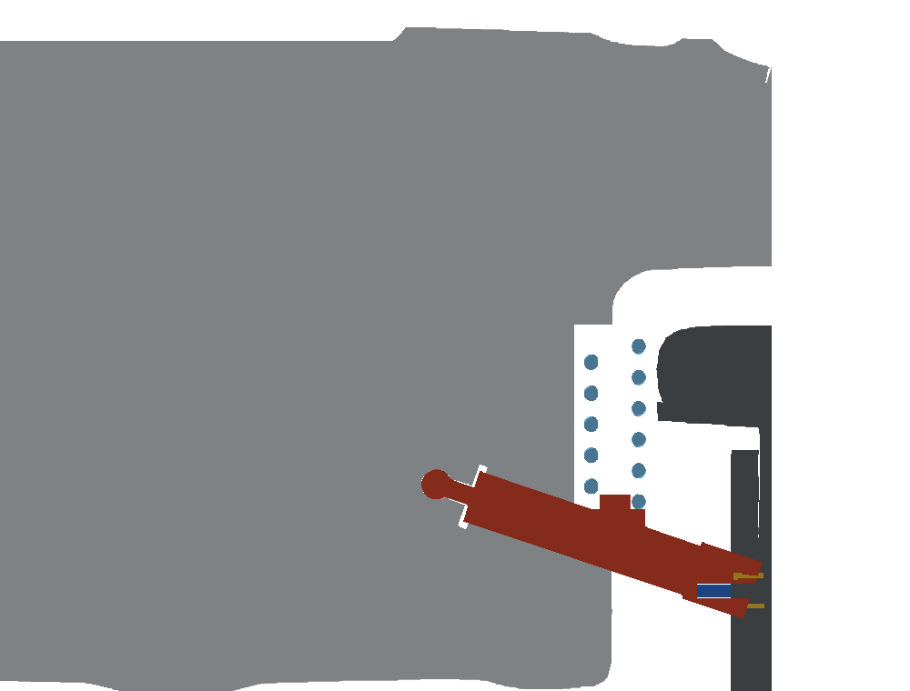

# VW Tayron — модель с подвеской под печать на PLA

Кузов Tayron + независимая подвеска на 4 колеса, **целиком печатаемая на FDM из PLA**:
прямой рычаг, витая пружина, балка 217 и втулка 224 из проекта `Single_color.3mf`.
Техническое задание, по которому это сделано (и по которому можно повторить),
лежит в [`DESIGN.md`](DESIGN.md).


Разрез через шарнир (видно, что шар рычага сидит внутри кузова):



## Что в репозитории

| Файл | Что это |
|---|---|
| `Tayron3_suspension.3mf` | Печатная сборка, 21 объект: кузов с пазами + 4 рычага + 4 балки + 4 втулки + 4 пружины + 4 колеса |
| `run.py` | Запуск сайта: сам поднимает сервер и открывает страницу |
| `suspension/` | Сайт с интерактивной демонстрацией (нагрузка в граммах, ход в мм) |
| `DESIGN.md` | ТЗ/промпт: ограничения PLA, формулы, критерии приёмки |
| `Модель №2 Tayron.3mf` | Исходная модель (кузов + колёса) |
| `Single_color.3mf` | Исходный проект пользователя (детали 217/220/221/224) |
| `reference/` | Фотографии машины |

## Механизм (v4)

1. **Рычаг** — прямая деталь 10 × 14 мм в вертикальной плоскости колеса (x = const),
   плечо 85 мм. **Один и тот же файл печатается 4 раза** — деталь симметрична,
   у всех колёс одинаковый угол. Снизу пятка 16 × 16 с пазом под балку.
2. **Крепление к кузову — шаровой шарнир-защёлка.** Наверху рычага шар Ø8 на шейке
   Ø5. В кузове вырезано гнездо Ø8.6 и горло **5.6 мм**: шар вставляется в горло с
   натягом (губка 1.5 мм пружинит) и после щелчка **обратно не выходит** — 8 > 5.6.
   Рычаг держится за кузов, а не «стоит в прорези». Внутри гнезда зазор 0.22–0.28 мм,
   поэтому рычаг свободно качается (и даже может повернуться вокруг шара).
   Собирается со стороны арки, без клея и винтов.
3. **Пружина** — печатная витая: провод Ø3.5, средний Ø13, 5.5 витка, свободная
   длина 46 мм. Стоит вертикально между площадкой рычага и карманом в кузове.

### Как печатать пружину (важно)

Ставить **стоя, осью вертикально**, слой 0.2 мм, **поддержки не нужны**:
витая пружина режется слоями как спиральный пандус — каждый следующий слой
лежит на предыдущем со сдвигом 0.18 мм, а промежутки между витками (4.9 мм)
остаются пустыми, их печатать не надо. Поддержки понадобятся только если
хочется поставить её лёжа.
4. **Балка 217** (×0.77) проходит сквозь пятку рычага и ступицу колеса,
   **втулка 224** (×1.2) — подшипник в ступице, колесо насажено на неё
   (отверстие Ø10.6).

Нагрузка идёт по замкнутой цепи: **кузов → паз → палец → рычаг → пружина
и балка → втулка → ступица колеса**. Консольных деталей нет.

### Числа

| Параметр | Значение |
|---|---|
| Плечо рычага (шарнир → центр колеса) | 85 мм |
| Пружина (PLA, G = 1200 МПа) | `k = G·d⁴/(8·D³·n) = 1200·150/(8·2197·5.5) = 1.86 Н/мм` |
| Жёсткость на колесе | `1.86 · 0.565² = 0.59 Н/мм` |
| Напряжение в проводе при полном ходе | τ = 8FD/(πd³) ≈ 12 МПа (предел PLA 50 МПа) |
| Масса модели / просадка | ≈ 1.5 кг → 6 мм |
| Ход до упора в арку | 12 ед. = 64 мм |
| Клиренс кузова | 197 мм ⇒ на землю не садится даже при полном ходе |

## Сайт

```bash
python3 run.py               # сам найдёт свободный порт и откроет браузер
python3 run.py --port 8080 --no-browser
```

Нагрузка задаётся **в граммах** (модель весит ~1.5 кг), жёсткость пружины —
ползунком 0.3–2 Н/мм (по умолчанию 0.7 — как у напечатанной). Пружины на схеме
сжимаются вместе с ходом рычага.

## Проверка сборки (замеры, не на глаз)

| Стык | Зазор |
|---|---|
| шар рычага ↔ гнездо кузова | 0.22–0.28 мм (шар Ø8 в гнезде Ø8.6) |
| горло гнезда | **5.6 мм** — меньше шара Ø8 ⇒ рычаг защёлкнут и не выпадает |
| рычаг ↔ кузов при 0°, +9°, −9° | 0.22–0.40 мм (не задевает на всём ходу) |
| пружина ↔ рычаг (площадка) | **0.00** (лежит на площадке) |
| пружина ↔ кузов | **1.6–1.8 мм** |
| балка ↔ рычаг (паз) | 0.0–0.2 мм (посадка под клей) |
| балка ↔ кузов | **19 мм** |
| рычаг ↔ колесо | 2.3–3.0 мм |
| колесо ↔ кузов | 7.3 мм в покое → **0.1 мм при 9°** (это и есть предел хода) |

Все тела (кузов + 4 колеса + рычаги + пружины) watertight; в 3MF нет вырожденных
треугольников, индексы в пределах своих объектов. Пружина watertight и весит
≈2.6 г PLA.

## Как ведёт себя (k = 0.7 Н/мм на колесо)

| Нагрузка | Крен | Тангаж | Просадка | Ход ПЛ / ПП / ЗЛ / ЗП |
|---|---|---|---|---|
| 0.5 кг на ПЛ | 0.12° | 0.07° | 1.8 мм | +5 / +2 / +2 / −2 мм |
| 1.5 кг на крышу | 0° | 0° | 5.3 мм | 5 / 5 / 5 / 5 мм |
| 0.8 кг в багажник | 0° | 0.12° | 2.8 мм | 0 / 0 / 6 / 6 мм |
| 1.6 кг на левый борт | 0° | 0.23° | 5.6 мм | 0 / 0 / 11 / 11 мм |
| 1.5 кг по диагонали | 0° | 0° | 5.3 мм | 5 / 5 / 5 / 5 мм |
| 5 кг ровно | 0° | 0° | 17.5 мм | упор в арку (12 мм) |

Напечатанная модель на своих пружинах проседает на 5–6 мм под собственным весом
и выбирает ход до упора при ~1.8 кг на колесо.
