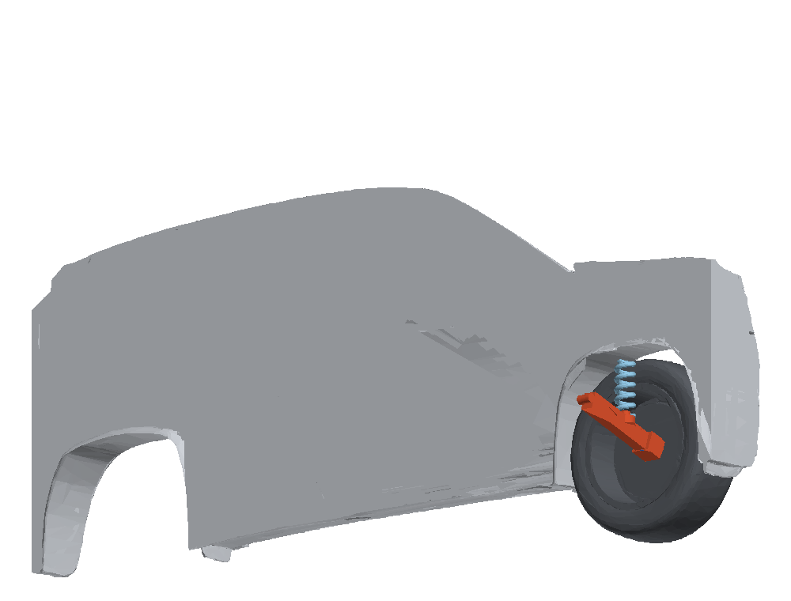

# VW Tayron — модель с подвеской под печать на PLA

Кузов Tayron + независимая подвеска на 4 колеса, **целиком печатаемая на FDM из PLA**:
прямой рычаг, витая пружина, балка 217 и втулка 224 из проекта `Single_color.3mf`.
Техническое задание, по которому это сделано (и по которому можно повторить),
лежит в [`DESIGN.md`](DESIGN.md).



Разрез через шарнир (видно, что шар рычага сидит внутри кузова):


## Что в репозитории

| Файл | Что это |
|---|---|
| `Tayron3_suspension.3mf` | Печатная сборка, 21 объект: кузов с пазами + 4 рычага + 4 балки + 4 втулки + 4 пружины + 4 колеса |
| `run.py` | Запуск сайта: сам поднимает сервер и открывает страницу |
| `suspension/` | Сайт с интерактивной демонстрацией (нагрузка в граммах, ход в мм) |
| `DESIGN.md` | ТЗ/промпт: ограничения PLA, формулы, критерии приёмки |
| `Модель №2 Tayron.3mf` | Исходная модель (кузов + колёса) |
| `Single_color.3mf` | Исходный проект пользователя (детали 217/220/221/224) |
| `reference/` | Фотографии машины |

## Печать в 150 мм (масштаб 17 %)

Файл остаётся в исходных единицах (кузов 882 ед.), печатать **уменьшенным до 150 мм
по длине** (в слайсере 17 %). Все размеры механизма подобраны под этот масштаб —
в скобках то, что получится на столе:

| Деталь | В файле | Напечатается |
|---|---|---|
| Рычаг — тело | 12 × 17.6 ед. | **2.0 × 3.0 мм** |
| Рычаг — длина | 85 ед. | 14.4 мм |
| Головка шарнира | Ø15.3 ед. | Ø2.6 мм (в конусном гнезде Ø3.6, **на клей**) |
| Балка 217 (×1.8) | 8.6 × 7.3 × 75 ед. | 1.5 × 1.2 × 12.7 мм |
| Втулка 224 (×4.0) | Ø32 / отв. Ø12.4 ед. | Ø5.4 / Ø2.1 мм |
| Отверстие в колесе | Ø37.9 ед. | Ø6.4 мм |
| Пружина | провод Ø5.9, Ø34 ед. | провод **1.0 мм, наружный Ø5.8, длина 12 мм** |
| Зазоры в подвижных парах | 2.9 ед. | **0.19–0.45 мм** |
| Ход подвески | 12 ед. | **2.0 мм** |
| Масса модели | — | ≈10–15 г, просадка 0.1 мм |

Что важно знать про этот масштаб:

* **Защёлку шарнира печатать бессмысленно** — губка вышла бы 0.3 мм. Поэтому шар
  Ø2.6 вставляется в конусное гнездо и **приклеивается**; гнездо держит его от
  проворота и сдвига, клей — от выпадения. Если хочется механический замок,
  шар надо увеличить до Ø4 мм (тогда губка 0.4 мм и она работает).
* Ход всего 2 мм — на глаз почти не видно; чтобы подвеска «играла», печатайте
  крупнее (30 см ⇒ ход 4 мм, 45 см ⇒ 6 мм), крепления масштабируются вместе с файлом.

## Механизм (v5)

1. **Рычаг** — прямая деталь 10 × 14 мм в вертикальной плоскости колеса (x = const),
   плечо 85 мм. **Один и тот же файл печатается 4 раза** — деталь симметрична,
   у всех колёс одинаковый угол. Снизу пятка 16 × 16 с пазом под балку.
2. **Крепление к кузову — шаровой шарнир-защёлка.** Наверху рычага шар Ø8 на шейке
   Ø5. В кузове вырезано гнездо Ø8.6 и горло **5.6 мм**: шар вставляется в горло с
   натягом (губка 1.5 мм пружинит) и после щелчка **обратно не выходит** — 8 > 5.6.
   Рычаг держится за кузов, а не «стоит в прорези». Внутри гнезда зазор 0.22–0.28 мм,
   поэтому рычаг свободно качается (и даже может повернуться вокруг шара).
   Собирается со стороны арки, без клея и винтов.
3. **Пружина** — печатная витая: провод Ø3.5, средний Ø13, 5.5 витка, свободная
   длина 46 мм. Стоит вертикально между площадкой рычага и карманом в кузове.

### Как печатать пружину (важно)

Ставить **стоя, осью вертикально**, слой 0.2 мм, **поддержки не нужны**:
витая пружина режется слоями как спиральный пандус — каждый следующий слой
лежит на предыдущем со сдвигом 0.18 мм, а промежутки между витками (4.9 мм)
остаются пустыми, их печатать не надо. Поддержки понадобятся только если
хочется поставить её лёжа.
4. **Балка 217** (×0.77) проходит сквозь пятку рычага и ступицу колеса,
   **втулка 224** (×1.2) — подшипник в ступице, колесо насажено на неё
   (отверстие Ø10.6).

Нагрузка идёт по замкнутой цепи: **кузов → паз → палец → рычаг → пружина
и балка → втулка → ступица колеса**. Консольных деталей нет.

### Числа

| Параметр | Значение |
|---|---|
| Плечо рычага (шарнир → центр колеса) | 85 мм |
| Пружина (PLA, G = 1200 МПа) | `k = G·d⁴/(8·D³·n) = 1200·150/(8·2197·5.5) = 1.86 Н/мм` |
| Жёсткость на колесе | `1.86 · 0.565² = 0.59 Н/мм` |
| Напряжение в проводе при полном ходе | τ = 8FD/(πd³) ≈ 12 МПа (предел PLA 50 МПа) |
| Масса модели / просадка | ≈ 1.5 кг → 6 мм |
| Ход до упора в арку | 12 ед. = 64 мм |
| Клиренс кузова | 197 мм ⇒ на землю не садится даже при полном ходе |

## Сайт

```bash
python3 run.py               # сам найдёт свободный порт и откроет браузер
python3 run.py --port 8080 --no-browser
```

**Анимация сборки.** Кнопка «Разобрать» (или ползунок 0–100 %) разносит машину
на детали в порядке разборки: сначала сходят колёса, за ними балка с втулкой,
потом рычаг выходит из гнезда вдоль своей оси, последней поднимается пружина.
Сборка идёт в обратном порядке (те же кнопки), физика на время разборки
замораживается.

**Как в игровом движке.** Сайт не считает статическую формулу — он крутит
твёрдое тело с гравитацией: кузов 1.5 кг на четырёх пружинах с демпфером
(3 степени свободы: просадка, крен, тангаж), шаг интегрирования 1/720 с.
Поэтому кузов **качается и успокаивается**, а не телепортируется в новое
положение: нагрузка → просадка с перерегулированием ~20 % → затухание за 1–2 с.
Кнопка «Тряхнуть» даёт вертикальный импульс 520 мм/с, ползунки «Масса» (0.5–3 кг)
и «Демпфер» (0.05–0.8) меняют инерцию и затухание — видно, как меняется характер
колебаний.

Нагрузка задаётся **в граммах** (модель весит ~1.5 кг), жёсткость пружины —
ползунком 0.3–2 Н/мм (по умолчанию 0.7 — как у напечатанной). Пружины на схеме
сжимаются вместе с ходом рычага, шина остаётся на земле.

## Проверка сборки (замеры, не на глаз)

| Стык | Зазор |
|---|---|
| рычаг ↔ кузов при 0°, +9°, −9° | **0.19–0.45 мм** (на всём ходу, в мм печати) |
| балка ↔ кузов при 0°, +9°, −9° | 0.22–2.06 мм |
| пружина ↔ площадка рычага | 0.38 мм (лежит на площадке) |
| пружина ↔ кузов | 0.31 мм |
| пружина ↔ рычаг (площадка) | **0.00** (лежит на площадке) |
| пружина ↔ кузов | **1.6–1.8 мм** |
| балка ↔ рычаг (паз) | 0.0–0.2 мм (посадка под клей) |
| балка ↔ кузов | **19 мм** |
| рычаг ↔ колесо | 2.3–3.0 мм |
| колесо ↔ кузов | 7.3 мм в покое → **0.1 мм при 9°** (это и есть предел хода) |

Все тела (кузов + 4 колеса + рычаги + пружины) watertight; в 3MF нет вырожденных
треугольников, индексы в пределах своих объектов. Пружина watertight и весит
≈2.6 г PLA.

## Как ведёт себя (k = 0.7 Н/мм на колесо, масса 1.5 кг, ζ = 0.22)

| Нагрузка | Крен | Тангаж | Просадка | Пик просадки | Ход ПЛ / ПП / ЗЛ / ЗП |
|---|---|---|---|---|---|
| 0.5 кг на ПЛ | 0.65° | 0.38° | 1.8 мм | 2.1 мм | +4 / +1 / +1 / −2 мм |
| 1.5 кг на крышу | 0° | 0° | 5.3 мм | 6.3 мм | 5 / 5 / 5 / 5 мм |
| 0.8 кг в багажник | 0° | 0.61° на корму | 2.8 мм | 3.4 мм | 0 / 0 / 5 / 5 мм |
| 1.6 кг на левый борт | 1.26° | 0° | 3.4 мм | 3.6 мм | +7 / −3 / +7 / −3 мм |
| 1.5 кг по диагонали | 0° | 0° | 5.3 мм | 6.3 мм | 5 / 5 / 5 / 5 мм |
| 3 кг ровно | 0° | 0° | 6.8 мм | 7.1 мм | 7 / 7 / 7 / 7 мм |

Статическое сжатие пружин под собственным весом — 5.3 мм (это и есть запас хода
до отбойника: полный ход 12 мм). «Тряхнуть» раскачивает кузов до ±6.5 мм и он
гаснет за 1–2 с.
