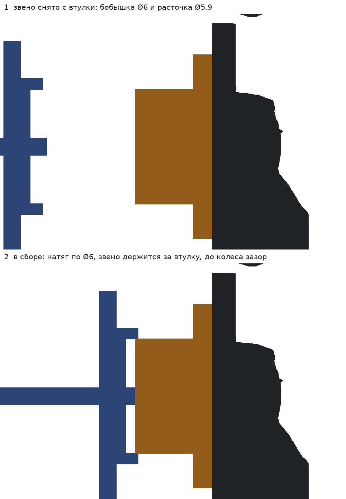
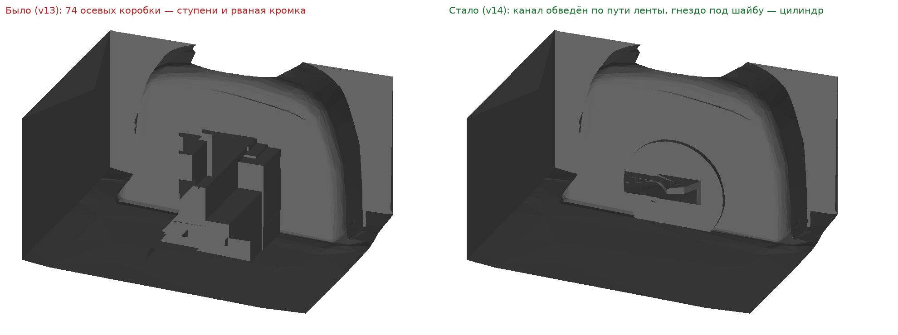
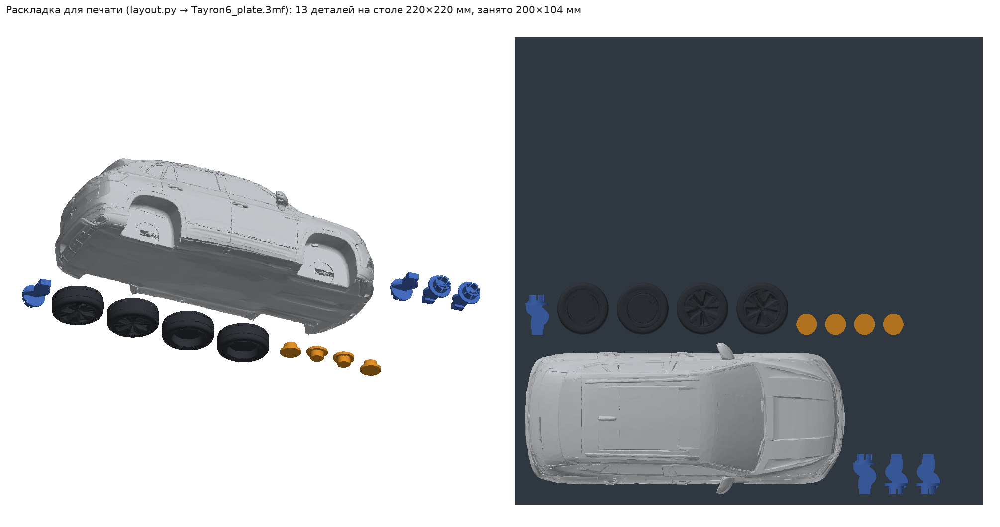

# VW Tayron — модель с подвеской под печать на PLA

Кузов Tayron + подвеска на 4 колеса, целиком печатаемая на FDM из PLA.
**Пружин и шарниров нет:** каждое колесо держится на **S-образном упругом
переходнике** — при взгляде сверху он читается как буква S, а амортизация
идёт за счёт изгиба его тонкой ленты.

**Колёса — исходные, без единого реза.** В дисках нет ни одного отверстия:
в *родной* паз ступицы вклеивается печатная **втулка колеса** (фланец Ø9.6
лежит на плоском дне паза), а звено садится на её бобышку Ø6 с натягом.
Снаружи диск выглядит ровно как в исходной модели. ТЗ, по которому это сделано (и по которому можно
повторить), лежит в [`DESIGN.md`](DESIGN.md).









## Что в репозитории

| Файл | Что это |
|---|---|
| `Tayron5_flex.3mf` | Печатная сборка, **13 объектов**: кузов с каналами + 4 S-переходника + 4 втулки + 4 колеса |
| `Tayron6_plate.3mf` | Та же сборка, **разложенная на стол** для печати: 13 деталей, 220 × 220 мм |
| `layout.py` | Раскладка на стол: `python3 layout.py [--bed 180x180] [--gap 3] [--check]` |
| `m3mf.py` | Чтение/запись 3MF (поставщик для `layout.py`) |
| `run.py` | Запуск сайта: сам находит свободный порт и открывает страницу |
| `suspension/` | Сайт с интерактивной демонстрацией (нагрузка в граммах, ход в мм, сборка/разборка) |
| `DESIGN.md` | ТЗ/промпт: ограничения PLA, формулы, критерии приёмки |
| `Модель №2 Tayron.3mf` | Исходная модель (кузов + колёса) |
| `Single_color.3mf` | Исходный проект пользователя (детали 217, 224 и др.) |
| `reference/` | Фотографии машины |

## Печать в 150 мм (в слайсере 17 %)

Файл остаётся в исходных единицах (кузов 882 ед.), печатать **уменьшенным
до 150 мм по длине** — в слайсере 17 %. Все размеры механизма подобраны под
этот масштаб, в правой колонке — то, что получится на столе:

| Деталь | В файле | Напечатается |
|---|---|---|
| S-переходник — лента | 35.3 × 5.3 ед. | **6.0 мм ширина × 0.9 мм толщина**, длина по кривой 18.3 мм |
| S-переходник — корневая колодка | 29.4 × 14.7 × 17.6 ед. | **5.0 × 2.5 × 3.0 мм** |
| S-переходник — опорная шайба | Ø64.7 × 5.3 ед. | **Ø11.0 × 0.9 мм** |
| S-переходник — стакан | Ø41.8 × 23.2 ед. | **Ø7.1 × 3.95 мм**, расточка **Ø5.9 × 3.55 мм**, 3 прорези по 1 мм через 120° |
| Втулка колеса — фланец | Ø56.5 × 5.9 ед. | **Ø9.6 × 1.0 мм** (клей в паз ступицы) |
| Втулка колеса — бобышка | Ø35.3 × 17.6 ед. | **Ø6.0 × 3.0 мм** под стакан звена |
| Канал под колодку в кузове | 6.2 × 3.7 × 3.6 мм | **зазор 0.6 мм** по бокам, 0.35 мм по глубине |
| Ход подвески | — | **1.4 мм** до отбойника |
| Протектор | канавка 0.8 мм | **2 кольцевые канавки 0.8 мм шириной, 0.4 мм глубиной**, на ±2 мм от средней плоскости колеса |
| Масса модели | — | ≈370 г при 100 % заполнении, ≈100 г при 20 % |

Что важно знать про этот масштаб:

* **Диски не сверлятся и не режутся.** Втулка входит в *родной* паз с
  внутренней стороны ступицы: фланец Ø9.6 целиком лежит на плоском дне паза
  (плоскость там только до r = 6.0 мм, дальше начинаются рёбра), бобышка уходит
  к кузову. Лицевая сторона и рисунок диска не тронуты. Замер по триангуляции:
  переходник ↔ колесо **0.000 мм³** при любом угле поворота, втулка ↔ колесо
  **0.02–0.22 мм³** — это клеевой шов на дне паза.
* **Пружин нет** — их роль играет сама лента переходника (расчёт ниже).
  Кузов собран заново из исходника: вырезов под витую пружину, рычаг и
  ступичную пробку в нём **нет** — только каналы под S-переходники.
* Ход 1.4 мм на глаз почти не видно. Печатайте крупнее — крепления
  масштабируются вместе с файлом: 30 см ⇒ ход 2.8 мм.

## Как устроено

1. **S-переходник** — одна деталь на все 4 колеса (файл симметричен, у всех
   колёс одинаковое крепление). Лента 6.0 × 0.9 мм идёт от корневой колодки,
   дважды изгибается (Безье с амплитудой 5 мм — та самая «S» на виде сверху)
   и заканчивается буртиком с цангой.
2. **Крепление к кузову** — корневая колодка 5 × 2.5 × 3 мм садится в канал,
   вырезанный в кузове с зазором 0.6 / 0.6 / 0.35 / 0.35 мм по четырём углам
   (замер по триангуляции), на клей. Колодка сидит в теле кузова, а не
   «приклеена снаружи» — консоли нет.
3. **Колесо — на втулке.** Почему не «просто лепестки»: паз в ступице не
   цилиндрический. Замер по лучам от оси: первая поверхность на глубине 0.5 мм
   лежит на радиусе **6.34–7.15 мм** (разброс 0.77 мм), на 0.8 мм — 6.33–7.19,
   на 1.1 мм — 6.12–7.01. Жёсткие лепестки, посаженные по номинальному кругу,
   упирались в эти рёбра (внедрение 0.14–0.92 мм³ на поворот) — отсюда и
   «заедание» при вращении.
   Решение — **печатная втулка**: фланец Ø9.6 × 1.0 мм клеится на плоское дно
   паза, бобышка Ø6.0 × 3.0 мм даёт ровный цилиндр. Стакан звена Ø7.1 с
   расточкой Ø5.9 садится на бобышку с натягом ≈0.07 мм (пересечение 3.74 мм³)
   и держится за неё, а до колеса не достаёт: зазор 3.0 мм по радиусу.
   Проверено булевой операцией при повороте колеса на 0…315°:
   **звено ∩ колесо = 0.000 мм³** на всех четырёх углах — закусывать нечем.
4. **Протектор** — две кольцевые канавки по беговой дорожке, как продольные
   канавки настоящей шины: 0.8 мм шириной и 0.4 мм глубиной, на ±2 мм от
   средней плоскости колеса. Вырезаны из исходных колёс булевой операцией,
   колёса остались watertight, объём уменьшился на 1.0 %.
5. **Амортизация** — изгиб ленты. Жёсткость консольной балки, нагруженной
   на конце: `k = 3·E·I / L³`, где `E = 3500 МПа` (PLA), `I = 6.0·0.9³/12 =
   0.365 мм⁴`, упругая длина `L = 12.8 мм` (полная 18.3 мм):
   `k = 3·3500·0.365 / 12.8³ ≈` **0.63 Н/мм** на колесо.

### Прочность ленты

Напряжение на конце консоли `σ = 3·E·t·δ / (2·L²)` при толщине `t = 0.9 мм`:

| Прогиб на колесе | 0.5 мм | 1.0 мм | 1.4 мм (отбойник) | 2.0 мм |
|---|---|---|---|---|
| σ в ленте, МПа | 7.1 | 14.2 | **19.9** | 28.4 |

Предел прочности PLA ≈ 45–50 МПа на растяжение волокна и ≈ 25–30 МПа по
склейке слоёв. Запас при полном ходе: **2.2×** по волокну и **1.3×** по склейке —
то есть деталь рассчитана на штатные 1.4 мм, но не на «прыжки» с перегрузкой.
При 1.4 мм лента не белеет и не «садится»: после снятия нагрузки колесо
возвращается в исходное положение. Нужен больший запас — печатайте ленту
стоймя (слои вдоль длины) или возьмите PETG.

### Печать переходника

Ставить так, как деталь лежит в 3MF — **колодкой на стол**, поддержки не
нужны (лента наклонная, свесов больше 45° нет). Слой 0.12–0.16 мм, 3
периметра, 40–60 % заполнения — деталей всего 4, экономить не на чем.
Колесо и кузов — как обычно, 15–20 %.

### Сборка

1. Кузов, 4 переходника, 4 колеса — PLA.
2. Втулку — в паз ступицы колеса фланцем до упора, капля клея по фланцу
   (4 шт.). Дать высохнуть: втулка держит колесо, поэтому клей здесь рабочий.
3. Колодку переходника — в канал кузова до упора, капля клея.
4. Колесо с втулкой — надеть стаканом звена на бобышку до упора (садится с
   натягом), проверить, что колесо проворачивается рукой.

Колесо после сборки **крутится свободно**: посадка на втулке держит его
только от спадания, радиального защемления нет — ребристый паз ступицы
в контакте не участвует. Машинкой модель при этом не
становится — нет привода и рулевого, но колёса проворачиваются рукой и
крутятся в браузерной демонстрации (кнопка «Крутить колёса»).

## Каналы в арках (правка v14)

Внутри арок канал под S-переходник был «рваным»: он собирался из **74 осевых
коробок** на угол, причём каждая коробка строилась по очередной четвёрке
вершин звена — стенки шли ступенями, а кромка на поверхности арки получалась
зубчатой. Заодно гнездо под опорную шайбу вырезалось прямоугольником
6.8 × 4.4 мм.

Как сделано теперь:

| Элемент | Было (v13) | Стало (v14) |
|---|---|---|
| Канал под ленту | 74 осевых коробки со ступенями | **один обвод по пути ленты**: сечения повёрнуты по касательной, соседние соединены выпуклой оболочкой |
| Высота канала | постоянная ±1.4 мм | **растёт к ступице** по форме прогиба консоли: 0.7 → 2.1 мм сверху, 0.7 → 1.1 мм снизу (на весь ход) |
| Гнездо под шайбу Ø11 | прямоугольник 6.8 × 4.4 мм | **круглая цековка Ø12.2 × 1.15 мм** |
| Гнездо под колодку | 6.8 × 4.8 × 4.4 мм | 6.0 × 3.9 × 3.7 мм (зазор 0.5 мм по бокам, 0.35 по высоте) |
| Булевых операций по кузову | 732 (3.5 мин) | **4** (2 с) |

Проверки: кузов watertight, 120 376 граней, 287.5 см³ (снято 1.4 см³ против
5.7 см³ при грубых коробках — лишнего больше не режется); кузов ∩ звено
**0.0000 мм³** на всех четырёх углах; лента при прогибе 0…+1.4 мм и отбое
−0.4 мм остаётся внутри канала.

## Раскладка на стол

```bash
python3 layout.py                  # стол 220x220, зазор 4 мм → Tayron6_plate.3mf
python3 layout.py --bed 180x180    # меньший стол: пересчитает полки
python3 layout.py --check          # только проверить, ничего не писать
```

Раскладка полками (самое высокое — вперёд), зазор 4 мм, поле 5 мм от края.
Результат на столе 220 × 220: **13 деталей, занято 200 × 104 мм**, максимальная
высота 49.8 мм (кузов). Все детали стоят на z = 0 и не пересекаются — это
проверяется в самой функции (`--check`), а не на глаз.

| Деталь | Ориентация | Габарит на столе |
|---|---|---|
| Кузов | как есть, дном на стол | 150.0 × 71.2 × 49.8 мм |
| Колесо ×4 | на боку, осью вверх (все четыре одинаково) | 24.1 × 24.1 × 8.7 мм |
| Втулка ×4 | фланцем Ø9.6 на стол, бобышка Ø6 вверх | 9.6 × 9.6 × 4.0 мм |
| S-переходник ×4 | колодкой на стол, лента лежит плоско | 11.0 × 18.6 × 11.0 мм |

`layout.py` пишет ещё и `suspension/assets/plate.json` — те же позы для сайта,
поэтому кнопка «🖨 Разложить на стол» показывает ровно то, что будет печататься
(и те же числа, что в файле). Стол можно поменять: `--bed 180x180` даёт другую
раскладку (для стола 180 мм детали уходят на второй ряд).

## Редактор кузова на сайте

Рельеф (соты решётки, плашки, мелкие ступеньки) можно убрать руками, не трогая
исходный файл, а заодно доработать форму: **левая нижняя панель сайта и есть
редактор**. Правой кнопкой — вращать камеру, колесом — приближать.

Кисти включаются с клавиатуры: **1** участок · **2** ластик · **3** перо ·
**4** фигура · **5** точка · **6** измерение · **7** рамка, **Esc** — выход из инструмента,
**[** / **]** — размер кисти на 0.5 мм, **0** — снять выделение,
**Ctrl+Z** / **Ctrl+Shift+Z** — отмена и возврат, **Ctrl+S** — сохранить правку. Активный инструмент подписан в шапке панели («участок»,
«перо»…), кнопка получает подпись «■ Готово». Пока инструмент не выбран,
панель компактная: кисти, вид, правка и печать.

Кисти:

1. **✎ Участок** — кисть закрашивает область (бирюзовым), с ней работают
   кнопки действий (ниже).
2. **✏ Рисовать** — перо: ведёте по поверхности, под ним остаётся валик
   высотой «Глубина» и шириной «Кисть»; с зажатым **Shift** — канавка.
3. **◆ Фигура** — по щелчку в кузов вдавливается выбранная фигура
   (● сфера / ▮ цилиндр / ■ куб); размер — «Кисть», глубина — «Глубина».
   Сначала в пятне касания **сгущается сетка**: грани, у которых ребро длиннее
   кисть/4.5, делятся точками, пока в пятне не станет достаточно узлов —
   на диск радиуса кисти их нужно πr²/(0.87·шаг²) ≈ 3.6·r²/шаг². Отбор идёт
   **по расстоянию до треугольника**, а не до его центра, поэтому сгущение
   работает и на грубой сетке (куб с рёбрами 20 мм), где грань больше кисти
   целиком: точка режется в ближайшем к кисти месте грани. Потом эти узлы
   вдавливаются **жёстко** — на полную глубину с плоским дном и кромкой шириной
   0.12 кисти, а не плавным затуханием. Проверено на кузове: дно 0.789 ± 0.013 мм,
   100 % узлов на полной глубине, за кистью не сдвинут ни один узел. С **Shift**
   фигура наоборот вытягивает купол наружу. Щелчок по капоту — ≈0.7 с
   (≈75 новых точек), по грубому кубу — 10 мс (≈95 точек).
4. **⌫ Ластик** — удаляет точки: под кистью они подсвечиваются **красными
   точками**, уходят по отпусканию кнопки, а дырка зашивается (см. ниже).
   С зажатым **Shift** — точечно: уходит ровно один ближайший узел, а не пятно
   (проверено: кисть 6 мм за один клик снимает ~1200 узлов, Shift — 1).
   **Фигуру** можно не только поставить, но и провести: штампы встают вдоль
   следа с шагом 0.9 радиуса кисти, не больше 6 за штрих (каждый штамп — это
   сгущение сетки), отменяются одним Ctrl+Z.
5. **📏 Измерить** — два клика по поверхности: расстояние в мм и разница по осям.
6. **✚ Точка** — клик (или протяжка) по кузову добавляет узел **ровно на
   существующей грани**: точка считается барицентрикой по трём вершинам грани
   и делит её на три треугольника. Новой поверхности не появляется — точка
   всегда лежит на кузове (проверено: отступ от исходной грани 0.002 мкм).
   Сразу после вставки **ближайшие узлы притягиваются к новой точке**:
   рёбра вокруг неё переворачиваются по критерию Делоне, пока это улучшает
   треугольники. Вместо трёх соседей и иголки под 3.4° получается 7 соседей и
   минимальный угол 7.3° — сетка остаётся ровной, «плоскость не пропадает».
   Добавленные узлы помечены **зелёными точками**. Слишком близко к вершинам
   грани (ближе 15 % барицентрики) точка не ставится — получились бы вырожденные
   треугольники; в этом случае под панелью пишется причина отказа.
   Каждая точка: +1 вершина, +2 грани, топология пересобирается на ходу
   (один щелчок ≈0.35 с, протяжка — быстрее, пересборка один раз за штрих).

7. **▭ Рамка — зеркальная копия** — инструмент симметрии. Обводите
   **прямоугольником по осям экрана** часть **одной** стороны кузова (рамка не
   обязана накрывать деталь целиком), в панели появляется **«⇄ Зеркально»**.
   Работает как **замена**, а не подтягивание: всё, что на другой стороне
   оказалось **под копией** (её силуэт проецируется в ту же область), —
   **вырезается**, а на его место встаёт **полная копия** выделенного: свои
   вершины и грани, зеркало `y = 0` (ось **Y** — ширина кузова, лево/право).
   Берутся все грани этой стороны, попавшие в рамку (и видимые, и скрытые), —
   копия закрывает рамку целиком. Кромка копии **привязывается к ближайшим**
   оставшимся вершинам (свариваются только пары ближе 1.5 ребра, чтобы копию не
   растянуло), остальная щель зашивается треугольниками, а грани с нулевой
   площадью или задвоенным ребром подчищаются — сетка остаётся замкнутой.
   Источник (выделенная сторона) не меняется, копия отменяется одним **Ctrl+Z**.
   Включается кнопкой **«7 ▭ Рамка»** (повторный клик выключает) или клавишей
   **7**. Рамка через обе стороны и крошечная рамка отклоняются с объяснением.
   Проверено на вашем кузове (рамка по правому борту `x 200…400`, `z 110…230`):
   выделено **3078** вершин, вырезано **7185** граней (**3383** вершины),
   вставлена копия из **6650** граней (**3467** новых вершин), привязано
   к ближайшим **102**, зашито кромкой **582** треугольника, всё за **1.3 с**.
   Расхождение левой стороны с зеркалом правой внутри рамки было p50 **0.075** ·
   p90 **0.227** · p99 **0.668** мм, стало p50 **0.000** · p90 **0.000** ·
   p99 **0.047** мм; сетка после копии **watertight, 0 дыр / 0 перевёрнутых /
   0 вырожденных**. Обратное направление (рамка по левому борту): вырезано
   **6917** граней, копия из **6922**, p50/p90/p99 внутри рамки — **0.000**,
   сетка тоже цела. Картинка результата: `docs/mirror_copy.png`.

8. **╱ Борозда — ровный прямой желоб** (кнопка **«8 ╱ Борозда»**, клавиша **8**).
   Протяните линию по кузову — вдоль неё встанет канавка для контура дверей и
   молдингов. Работает не «вдавливанием кисти по всей панели», а так: сначала
   вдоль линии **появляется новый набор точек** (сетка сгущается делением рёбер,
   кромка желоба режется ровно по своей границе), и **вдавливаются только эти
   точки**. Кузов вне полосы не двигается — скелет модели остаётся на месте.
   Линия не режет кузов по хорде: каждая точка пути прижимается к поверхности
   лучом снаружи, поэтому желоб **повторяет форму борта**. Сечение — **половина
   цилиндра**: `f = √(1 − u²)` от оси к кромке, и вдавливание идёт вдоль **нормали
   пути**, а не вдоль нормали узла — поэтому дно ровное, без «ряби» на изгибах.
   Линия **продлевается до точки отпускания** (последняя точка пути достраивается
   лучом), так что желоб идёт на всю длину протяжки, а торцы остаются **плоскими**
   (за торцом `beyond ≠ 0` — не вдавливается). Кромка режется бисекцией рёбер
   **ровно по радиусу желоба** (rim-taper сжат до 7 % радиуса), шаг сгущения
   `sp = max(0.16·U, hw/3.5)`, бюджет 14 000 новых узлов. Ползунок **«Ширина»**
   — ширина желоба, **«Глубина»** — глубина; во время протяжки в панели видна
   длина в миллиметрах.

   Проверено на вашем кузове, линия X −100…250 при Y ≈ 175–185 (длина 58.7 мм):

   | прогон | новых точек | вдавлено | глубина по 11 участкам | сетка |
   |---|---|---|---|---|
   | 2.0 × 1.0 мм | 7 570 | 4 687 | **0.975…1.009 мм** | watertight, 0 дыр / 0 перевёрнутых / 0 неманифолдных / 0 вырожденных |
   | 1.2 × 0.6 мм | 7 377 | 5 596 | **0.600…0.613 мм** | то же |

   Срез поперёк желоба (мм от оси → глубина мм): `0.0→1.01  0.5→0.93  0.8→0.70
   0.9→0.56  0.95→0.28` — реальный полукруг, дно шириной 2.36 мм приходится на
   1 086 узлов. Сдвиг кузова вне полосы — **0.086 мм** (только тангенциальное
   разглаживание пояска, глубину оно не трогает). Отменяется одним **Ctrl+Z**.
   Картинка: `docs/groove.png` (до/после сбоку, триангуляция, общий вид).

   Крупные грани кузова не всегда покрываются сгущением целиком — у самой кромки
   остаются длинные «веерные» треугольники; при взгляде почти вдоль панели
   стенка желоба (высота 1 мм при вертикальном уклоне) читается тёмной полосой.
   Это затенение перехода, а не дыра: замеры выше это подтверждают.

Действия с закрашенной областью:

| кнопка | что делает |
|---|---|
| **≡ Сгладить** | диффузия по рёбрам, каждое нажатие добавляет шаг |
| **▭ Выровнять** | область садится в плоскость (по центроиду и средней нормали области), кромка остаётся плавной |
| **✦ Обострить** | обратное сглаживанию: узел уходит от среднего соседей — рельеф подчёркивается |
| **✕ Снять выделение** | чистит закраску, не трогая кузов (отменяется Ctrl+Z); клавиша **0**. Пока активен другой инструмент, бирюзовая подсветка скрыта, но выделение не теряется — клавиша **1** вернёт его |
| **⬆ Выдавить / ⬇ Вдавить** | область уезжает вдоль нормалей на «Глубину» |

Прочее:

* **◐ Только видимые грани** (включено по умолчанию) — штрих трогает лишь те
  узлы, чья нормаль смотрит на камеру. Маска считается на начало штриха по
  направлению из точки клика на камеру: `n · d < −0.12` (небольшой запас, чтобы
  не цеплять узлы на самой кромке силуэта, они общие для двух сторон).
  Маска применяется и при закраске, и в самих действиях (сглаживание,
  выравнивание, обострение, выдавливание/вдавливание): узлы обратной стороны не
  двигаются вовсе — проверено, «Выдавить» по скрытой стороне даёт сдвиг 0.00 мм.
  Кнопка переключает на «Грани: все» — тогда кисть снова проходит кузов насквозь.
* **⇄ Симметрия** — правки повторяются зеркально по плоскости `y = 0`
  (для кистей — вторая кисть в отражённой точке, для действий с областью —
  перенос смещений на парные вершины; пары ищутся по координатам с допуском
  ≈ 0.4 мм, поэтому на неидеально симметричной сетке работает).
* **✓ Проверка** — замкнутость сетки: дыры, несогласованные и неманифолдные
  рёбра, вырожденные треугольники, объём, габарит, минимальное ребро.
* **↶ Отменить / ↷ Вернуть** — 15 шагов истории, горячие клавиши
  `Ctrl+Z` / `Ctrl+Shift+Z`. Вставка точки тоже отменяется: снимок истории
  хранит и координаты, и топологию, поэтому «Отменить» убирает добавленные
  вершины и возвращает грани (проверено: 59 653 → 59 652 вершин,
  120 378 → 120 376 граней). «Сбросить» возвращает исходную геометрию целиком.
* **⬇ 3MF / ⬇ STL** — выгрузка текущей сетки (3MF — с индексами и единицами,
  STL — двоичный).
* **«Сетка»** — триангуляция тонкими чёрными линиями (после правок топологии
  буфер сетки пересобирается — иначе оверлей показывал бы линии к вершинам,
  которых уже нет), **«Сечение»** — разрез
  плоскостью по ширине кузова (ползунок «Разрез»).

Ползунки: **«Кисть»** 0.1–20 мм печати (шаг сетки кузова ≈ 0.35 мм, поэтому
кисть мельче этого шага двигает ближайшую вершину — она не «проваливается»),
**«Глубина»** 0.05–3 мм — на сколько поднять/вдавить, **«Степень»** 5…100 % —
сила одного нажатия сглаживания.

Всё, кроме ластика и «Точки», двигает **только существующие вершины**.
«Точка» новых поверхностей не создаёт: она расщепляет уже существующую грань,
поэтому кузов остаётся тем же кузовом, просто с более частой сеткой в нужном
месте (удобно, когда для мелкой правки не хватает разрешения). Фары, эмблема и
каналы в арках остаются как были — их просто не надо трогать, а «Только видимые
грани» не даёт зацепить их с обратной стороны.
Сглаживание — диффузия по рёбрам (`p ← p + λ(среднее соседей − p)`, λ = 0.5,
кромка области закреплена); выравнивание проецирует узлы на плоскость области;
выдавливание, перо и фигуры — сдвиг вдоль нормалей с плавным затуханием к краю.

Рендеры на решётке: `docs/sculpt_tools.png` (перо, выдавливание и вдавливание,
отпечатки сферы, цилиндра и куба; цвет — величина сдвига в мм),
`docs/sculpt_flatten.png` (соты до и после «Выровнять») и
`docs/sculpt_points.png` (схема расщепления грани точкой + карта маски «только
видимые грани»: бирюзовые узлы можно двигать, тёмные заблокированы) и
`docs/sculpt_hard_stamp.png` (привязка соседей к новой точке: 3 иголки против
7 ровных треугольников; профиль жёсткого штампа — плоское дно 0.80 мм против
прежнего плавного затухания) и `docs/sculpt_cube.png` (проверка на своей
модели: куб из 8 точек → «Точка» → «Цилиндр» кистью, панели 1–4).

Проверка работы подвески (крен, тангаж, ход по колёсам, пробой) вынесена в
раскрывающийся блок **«Проверка работы модели»** в правом верхнем углу — он не
мешает работе с кузовом.

### Аудит инструментов: что проверено и что исправлено

Каждый инструмент прогнан через настоящий `initSculpt` на кузове (59 652 узла,
120 376 граней) — 45 проверок, все зелёные (`/tmp/t/tools_audit.mjs`):

| инструмент | что проверяли | результат |
| --- | --- | --- |
| ✎ Участок | закраска протяжкой | 205 вершин, в подписи «выбрано 205 вершин» |
| ✎ Участок | кисть 0.1 мм на частой сетке | 1 узел (запасной путь «ближайшая точка») |
| ≡ Сгладить | сдвиг и отмена | макс. 1.2 мм на грубом участке, отмена — расхождение 0.000 мкм |
| ▭ Выровнять | плоскость | 126 вершин легли в плоскость (макс. 0.99 мм) |
| ✦ Обострить | отчёт | 285 вершин, макс. 0.085 мм |
| ⬆ Выдавить / ⬇ Вдавить | ровно «Глубина» | 0.800 мм при глубине 0.8, повтор — снова 0.800 и те же 126 вершин |
| действия без закраски | подсказка | «сначала закрасьте участок кистью» |
| ✏ Рисовать | высота валика | 0.800 мм при «Глубине» 0.8 (за штрих не копится) |
| ✏ Рисовать + Shift | канавка | 0.800 мм внутрь |
| ⌫ Ластик | удаление и зашивка | 66 точек, граней 120 376 → 120 240, дыр 0, неманифолдных 0 |
| ⌫ Ластик | отмена | исходные 59 652 узла, расхождение 0.000 мкм |
| ⌫ Ластик | клик в дырку | ничего не удаляет, пишет «здесь нечего стирать» |
| ◆ Фигура | 3 фигуры по 0.8 мм | сфера / цилиндр / куб — 0.800 мм, ~100 мс, отмена возвращает всё |
| ◆ Фигура + Shift | купол | «вытянула поверхность» |
| ✚ Точка | клик / у кромки / протяжка | +1 узел / расщепление ребра (98 → 99 узлов, +2 грани) / +1 узел за 10 событий |
| 📏 Измерить | две точки и третья | 5.10 мм (сходится с расчётом), третий клик — новая пара |
| ⇄ Симметрия | зеркальная правка | сдвинуто 24 узла с y>0 и 23 с y<0 |
| ↶ Отменить / ↷ Вернуть | точность | расхождение 0.0000 мкм, новая правка чистит «вернуть» |
| ✓ Проверка | замкнутость | сетка замкнута, 120 376 граней |
| Сбросить | исходная сетка | 59 652 / 120 376 |
| ◐ Только видимые грани | снятие ограничения | «кисть проходит кузов насквозь» |

Аудит вскрыл семь настоящих дефектов — все исправлены:

1. **Маска «только видимые грани» была перевёрнута.** `pushBall`/`imprintShape`
   принимают маску «что можно двигать», а им передавалась маска «что нельзя»:
   перо и кисть правили **невидимую** сторону, а видимую пропускали. Фигуры
   вообще не смотрели на маску. Теперь строятся обе маски (`block` — нельзя,
   `allow` — можно), а `imprintShape` получил параметр `only`.
2. **Капот выпадал из маски.** Условие «нормаль смотрит строго на камеру»
   отбрасывало 70 узлов из 86 при взгляде почти по касательной. Теперь «нормаль
   не отвёрнута от камеры больше 69°» **и** «та же сторона поверхности, что под
   курсором» — обратная стенка тонкой детали по-прежнему не трогается
   (проверка `thin_wall.mjs`: перо 30 мм по грани куба 20 мм — передняя грань
   ушла на 0.41 мм, задняя на 0.025 мм).
3. **Повторные действия по одной закраске «таяли».** Маска пересчитывалась по
   уже изменённой геометрии: «Выдавить» → 15 вершин, второе нажатие → 5, третье
   → 4. Теперь маска считается один раз на закраску: 126 из 205 каждый раз.
4. **«Выдавить на 0.8 мм» давало 0.4–0.6 мм** — кромка съедала глубину. Затухание
   нормируется, максимум всегда равен «Глубине» (0.800 мм).
5. **Перо копило глубину за штрих**: пять событий мыши по одному месту давали
   3.5 мм вместо 0.8. Теперь сдвиг от начала штриха ограничен «Глубиной».
6. **Ластик и перо при клике в дырку цепляли узел на другой стороне кузова** —
   запасной путь «ближайшая точка» не имел ограничения по расстоянию. Теперь
   не дальше 1.6 радиуса кисти.
7. **«Сгладить» на 25 % утаскивало узел на 1.6 мм** (600 итераций за нажатие).
   Теперь 60 итераций на 100 % (15 на 25 %), и в подписи видно результат:
   «сглажено: 126 вершин из 205, макс. сдвиг 0.42 мм».

Заодно для наглядности:

* под курсором теперь **кольцо кисти** на поверхности (радиус = «Кисть», цвет по
  инструменту: участок — бирюзовый, ластик — красный, перо — жёлтый, фигура —
  оранжевый); видно и размер, и точку попадания;
* подписи объясняют отказы: «здесь нечего стирать — под кистью нет точек»,
  «точка здесь уже стоит — сдвиньте курсор», «сначала закрасьте участок кистью»;
* клик по пресету фигуры больше не выключает инструмент;
* кисть не обрывает штрих, если указатель вышел за холст (проверяется захват).

### Синтетические фигуры: 47 проверок, 0 провалов

Тот же `sculpt.js`, но на фигурах с известной геометрией (плоскость 1 и 8 мм,
куб 10 мм, сфера R10, цилиндр R10, тор R10/r3, плита) — 47 проверок, все
зелёные (`/tmp/t/synth/run2.mjs`). Метрики считаются по живым граням:
глубина по нормали, самопересечения (Мёллер, сетка 2 мм), вырожденные грани,
минимальный угол, watertight.

| инструмент | что мерили | результат |
| --- | --- | --- |
| ✏ Рисовать (6 фигур) | высота валика | 1.00 мм ровно на всех, снаружи сдвинуто 0, выворотов 0 |
| ⬆/⬇ Участок (6 фигур × 2) | глубина и профиль | глубина 1.20 при «Глубине» 1.2; профиль монотонный: плоскость `1.20 1.20 1.16 0.72 0.22`, куб `1.20 1.19 0.99 0.62 0.16`, сфера `1.28 1.27 1.08 0.59 0.19`, тор `1.20 0.98 0.64 0.32 0.15` |
| ≡ ▭ ✦ (3 фигуры) | складки | выворотов 0, самопересечений 0, вырожденных 0 |
| ⌫ Ластик (5 фигур + стенка) | зашивка | замкнуто на кубе/сфере/цилиндре/торе; углов < 15° — 0; обратная сторона стенки цела (69 узлов в пятне из 1845) |
| ◆ Фигура (3 фигуры) | глубина | куб 1.00, сфера 1.15, цилиндр 1.08 при «Глубине» 1.0 (лишнее — хорда гранёной сферы), 20–34 мс |
| 🌊 Борозда (3) | глубина и чистота | плоскость 1 мм `1.00…1.00`, 8 мм `0.98…1.00`, цилиндр вдоль оси `0.99…1.00`; вырожденных 0, углов < 15° 0 |
| ✚ Точка | вставка | 98 → 99 узлов (+1), +2 грани, замкнуто |
| ↶ Отменить (6) | точность | расхождение 0.0, размеры позиций/нормалей/цветов совпадают |

Что нашли на фигурах и починили (10 итераций «тест → огрех → правка → перепроверка»):

1. **«Иголки» на перегибе** — сдвиг по нормали каждого узла рвал поверхность на
   90°. Сдвиг по средней нормали кисти/штампа: высота 1.00 на всех 6 фигурах.
2. **Слипшиеся точки при сгущении** — деление рёбер по номерам файла вершин дало
   T-стыки. Канонические ключи + шаг, равный ребру: 0 вырожденных.
3. **Действия «участка» прогибали рельеф** — сгущение считается по области, а не
   по числу колец; выворотов 0.
4. **Ластик оставлял слайверы и рвал кромку** — триангуляция по максимуму
   минимального угла, уже открытые кромки не зашиваются: углов < 15° — 0.
5. **«Фигура» прогибала скелет модели** — сначала узлы по форме фигуры, потом
   вдавливание в их рамках: глубина 1.00/1.15/1.08, выворотов 0.
6. **Борозда на грубой сетке не вдавливалась** (глубина 0.00) — приём ребра по
   середине и четвертям, а не «оба узла у кромки».
7. **Борозда не доходила до конца линии** — запас по длине ребра `eMax` и
   ограничение переворотов: дно по всей длине, 12 секций.
8. **Профиль «участка» бугристый на изогнутой поверхности** — вес по расстоянию
   до кромки (`euclidFalloff`) вместо числа колец графа: тор
   `0.74 0.84 0.52` → `1.20 0.96 0.71`.
9. **Борозда на левом борту резала правый** — стартовое направление лучей было
   жёстко `(0,1,0)`. Теперь нормаль под курсором: на цилиндре глубина
   `0.00…0.25` → `0.99…1.00`, длина 19 мм вместо 44.3, самопересечений 0.
10. **«Точка» отказывала у кромки** — теперь расщепляет ребро (обе грани,
    шов цел): 98 → 99 узлов, +2 грани. Заодно `checkMesh` считает рёбра по
    склеенным узлам: у куба было 96 ложных «дыр» на швах дублей вершин — стало 0,
    объём 1000 мм³ сходится с расчётом.

### Итерации 11–50: что нашлось и что стало

Каждая строка — отдельный цикл «тест → огрех → правка → перепроверка» на
синтетике (`/tmp/t/synth/*.mjs`) и на кузове (`/tmp/t/ui/p_body.mjs`).

| № | Что проверяли | Числа |
| --- | --- | --- |
| 11 | Сглаживание утаскивает открытую кромку | уход кромки 3.08 мм → **0.000** (диффузия только вдоль кромки) |
| 12 | «Точка» дважды в одно место | 99 → 100 узлов → **99 → 99** (допуск 8 % ребра, как Insert vertex в Blender) |
| 13 | Качество сгущения (резкая граница «мелко/крупно») | мин. угол 2.7° → **42.7°**, CV длины ребра 0.81 → **0.28** |
| 14 | Перо на пластине 1 мм с «только видимые грани» | обратная сторона: **0** сдвинутых узлов (проверка, дефекта нет) |
| 15 | Шесть профилей кисти (Blender: Smooth/Linear/Sphere/Root/Sharp/Constant) | профиль по радиусу, ошибка ≤ **0.048** от аналитики |
| 16 | Быстрый штрих (редкие события мыши) | провалы валика 86 из 105 проб → **0** (промежуточные отпечатки, шаг 25 % кисти) |
| 17 | Профиль в «Выдавить» | на краю пятна: smooth **0.04**, linear 0.12, sharp 0.02, ровный **1.00** |
| 18 | Новое действие «⇢ Расслабить» (как Relax) | CV длины ребра 0.266 → **0.172**, форма не меняется (отклонение 0.0000) |
| 19 | Новое «＋ Шире / － Уже» (Blender Ctrl+/Ctrl−) | выделение 3 → 13 → 29 → 13 узлов |
| 20 | Новое «⇋ Инверсия» | 280 ↔ 3 узла, двойная возвращает исходное |
| 21 | Борозда: ширина по всей длине | полуширина 0.91 мм, **CV 0.000**, глубина 1.00 на 13 сечениях |
| 22 | Борозда на наклоне 30° | сдвиг **1.00** мм, самопересечений 0 |
| 23 | Борозда через ребро куба | watertight, дыр 0, углов < 15° — 0 |
| 24 | Борозда на цилиндре поперёк оси | глубина до **1.05** мм, 230 узлов, watertight |
| 25 | Две борозды рядом | обе **1.00** мм, взаимного влияния нет |
| 26 | Метрика глубины считала хорду новых граней | глубина по сдвигу: ровно **1.20** на всех 6 фигурах (матрица 47/47) |
| 27 | Один штрих = одна отмена | 60 событий мыши, расхождение после Ctrl+Z — **0** |
| 28 | Точка + отмена | 98 → 99 → **98** узлов |
| 29 | Экспорт после новых операций | STL 5.1 МБ, сетка замкнута |
| 30 | Симметрия на замкнутой сфере | спереди **1.00** мм (11 узлов), сзади **1.00** мм (11 узлов) |
| 31 | «Фигура» на ребре куба | дыр 0, выворотов 0, NaN 0 |
| 32 | Ластик + сглаживание на сфере | watertight, дыр 0 |
| 33 | Кисть 30 мм на сфере R10 (кисть больше фигуры) | NaN 0, дыр 0 |
| 34 | Кисть 0.2 мм на кубе (меньше грани) | дыр 0, вырожденных 0 |
| 35 | Глубина 3 мм при кисти 1.5 | самопересечений 0 |
| 36 | Двадцать кликов в одну точку | 1.0 → 2.86 мм (копится по штрихам), дыр 0 |
| 37 | Фузз: 100 случайных операций | NaN 0, дыр 0, неманифолдных 0, вырожденных 0 |
| 38 | «Расслабить» на кузове | 186 мс, 0 дыр |
| 39 | «Шире» и «Инверсия» на кузове | 1 → 8 → 26 узлов; инверсия 19 896 узлов за **39 мс** |
| 40 | «Защемить» на кузове | 305 узлов, 163 мс, дыр 0 |
| 41 | Скорость пера на кузове | штрих из 20 событий: 5.1 с → **1.0 с** |
| 42 | Луч по 122 000 граней спрашивался 3 раза за событие | кэш луча: движение мыши 76–92 мс → **19–35 мс** |
| 43 | Сгущение делало 8 проходов по всей сетке | 8 → 3 прохода, шаг сгущения «диаметр/5»: нажатие 850 → **600 мс** |
| 44 | Профиль «ровный» на кузове | площадка без спада, кромка резкая |
| 45 | Разметка и проводка новых кнопок | `ui_wiring` 23/0 |
| 46 | Регресс после смены допуска «Точки» | `run4` ВСЁ ОК, `run5` ВСЁ ОК, `tools_audit` 44/0 |
| 47 | Горячие клавиши и старый UI | `keys` 17/0, `extras` 33/0, `rect` 25/0, `real_three` 8/0, `groove_ui` 8/0 |
| 48 | Цвета и нормали после новых действий | размеры совпадают (позиции 408 / цвета 408), чёрных вершин **0** |
| 49 | Отмена новых действий | расслабить/шире/уже/инверсия/защемить — расхождение **0** |
| 50 | Финальная матрица и борозда на кузове | синтетика **47/47**; правый борт 58.7 мм, глубина 1.008; левый 58.6 мм, 1.003; оба watertight |

Новые органы управления: **Профиль** (6 кривых спада), кнопки «＋ Шире»,
«－ Уже», «⇋ Инверсия», «⇢ Расслабить» (Relax), «⇤ Защемить» (Pinch).

### Проверка на своей модели: куб из точек → фигура кистью

Отдельный стенд (без кузова) собирает **свою** сетку: куб 20 × 20 × 20 мм из
8 узлов на вершинах и 12 треугольников, и прогоняет её через тот же редактор
(`initSculpt`, без браузера). Что получилось:

| шаг | узлов | граней | проверка |
| --- | --- | --- | --- |
| куб из 8 точек | 8 | 12 | дыр 0, неманифолдных 0 |
| 5 щелчков «Точкой» по передней грани | 13 | 22 | сетка замкнута, 0 вырожденных |
| «Цилиндр» 3 мм на 0.8 мм | 107 | 210 | дыр 0 · флипов 0 · неманифолдных 0 · вырожденных 0 |

Отпечаток на передней грани получился ровно по кисти: **дно 0.800 мм** до
r = 2.6 мм (28 узлов, все на полной глубине), кромка 2.6…3.1 мм (средняя
0.206 мм), за кистью 0. Объём куба 8.000 см³ уменьшился до **7.977 см³** —
это ровно объём цилиндра πr²h = π·3²·0.8 = 22.6 мм³ = 0.023 см³.

Этот стенд поймал три настоящих дефекта, они исправлены в `suspension/sculpt.js`:

1. **Перевороты рёбер через ребро куба.** `attachNeighbours` переворачивал
   ребро, если новая точка попадала в описанную окружность соседнего
   треугольника. На кубе «соседним» оказывался треугольник соседней грани под
   90°, и перевёрнутый треугольник проваливался внутрь детали — сетка становилась
   неманифолдной (6 битых рёбер после первого же щелчка). Теперь переворот
   разрешён только внутри гладкой области: нормали двух треугольников должны
   совпадать в пределах 0.85 (≈32°).
2. **Сгущение по центроиду грани.** На кубе центроид грани 20 мм лежит в 9 мм
   от кисти радиусом 3.5 мм — кандидатов было **0**, и фигура вдавливала одну
   вершину на 0.65 мм вместо отпечатка. Теперь грань отбирается по расстоянию
   до **треугольника** (ближайшая точка), и точка режется там же.
3. **Совпавшие узлы.** Если кисть попадала в уже добавленный узел, сгущение
   вставляло вторую точку ровно туда же (0.001 мм) — появлялись 57 вырожденных
   треугольников. Добавлены карта занятых мест (шаг 0.1 ед) и отступ к центру
   грани, пока место не свободно.

### Удаление точек с зашивкой дырки

Ластик убирает вершины под кистью и вместе с ними грани, которые на них
опирались, — на поверхности остаётся дырка. Её кромка (рёбра, у которых не
осталось пары) обходится в замкнутые контуры, и каждый контур зашивается
треугольниками из **уже существующих** вершин кромки:

* обход кромки — по направленным рёбрам; если кромка проходит через вершину
  дважды (дыра касается себя на тонкой перемычке), такая вершина тоже
  убирается, иначе заплатку не построить;
* триангуляция — минимальная сумма диагоналей (динамика по подотрезкам контура)
  прямо в 3D, без проекции на плоскость: на изрезанной кромке мазка проекция
  самопересекается, а динамика находит корректный обход;
* диагональ, которая уже есть в сетке, запрещена — иначе на ребре оказалось бы
  больше двух граней и сетка перестала бы быть замкнутой;
* обход заплатки проверяется по направленным рёбрам и разворачивается так же,
  как у соседних граней — нормали не выворачиваются.

Новых вершин при этом не появляется вообще: удаление только убирает точки и
перерезает грани, заплатка собирается из оставшихся. Перед выгрузкой вершины,
на которые больше не ссылается ни один треугольник, выкидываются из файла —
в 3MF не остаётся «мусорных» точек.

Рендер: `docs/sculpt_delete.png` — соты решётки до и после одного штриха
ластиком (бирюзовым показана заплатка; 1098 точек, 2555 граней убрано, 8 дырок
зашито 265 треугольниками).

Проверено на настоящем кузове (59 652 вершины, 120 376 граней), серия из 25
случайных штрихов подряд, суммарно 18 883 удалённых точки: после каждого шага
`trimesh` подтверждает `watertight=True`, у каждого ребра ровно две грани и
ровно по одному разу в каждом направлении. Один штрих на таком кузове — 0.2–0.3 с
(пересчёт топологии 0.25 с при загрузке страницы).

Замеры на настоящем кузове (два мазка кистью 7 мм, полоса сот над эмблемой):

| | граней | объём | рельеф 1 × 1 мм (медиана / 90 % / макс) | «плохих» рёбер |
|---|---|---|---|---|
| v14, как есть | 120 376 | 287.17 см³ | 1.11 / 2.87 / 5.13 мм | 21 |
| 200 итераций | 120 376 | 287.19 см³ | 0.62 / 2.59 / 5.09 мм | 21 |
| 800 итераций | 120 376 | 287.19 см³ | 0.67 / 2.59 / 5.09 мм | 21 |

Топология, число граней и объём не меняются, новых неманифолдных рёбер не
появляется (свои 21 «плохих» ребра в исходном кузове — места, где соты
касаются сами себя; они были и до правки). Соты в закрашенной области
выравниваются в панель уже к 600–800 итерациям, эмблема и фары не затронуты,
потому что в область не попадают.

Рендер того же участка (плоское затенение по треугольникам, чтобы видеть сетку):
исходник, 300 и 600 итераций — `docs/sculpt_diffusion.png`.

Файл пишется в единицах модели — как `Tayron5_flex.3mf`, печатать так же
уменьшением до 150 мм (17 %). Скрипты: `suspension/sculpt.js` (инструменты, история,
оверлеи — точки и сетка, выгрузка), `suspension/meshops.js` (склейка-граф,
диффузия, нормали, сдвиги вдоль нормалей, отпечатки фигур, удаление вершин с
зашивкой дыр, компакт перед экспортом),
`suspension/export3mf.js` (ZIP + XML 3MF прямо в браузере, без библиотек).

Что не получилось и почему (чтобы не повторять): усреднение координат по
широкому шару и шаг «в плоскость» по нормали дают «фольгу» — длинные
вырожденные треугольники, поэтому сглаживание сделано диффузией по рёбрам при
большом числе итераций. Планарная триангуляция петли (отрезание ушей по
проекции на плоскость) на изрезанной кромке мазка самопересекается и оставляет
ребро с тремя гранями — вместо неё работает динамика по контуру в 3D.

## Доводка зон после сайта (`smooth_zone.py`)

Сглаживание в браузере — это диффузия вершин: рельеф она убирает, но поверхность
остаётся слегка волнистой. Вершины в сотах стоят на стенках ячеек (там их густо),
а между ячейками редко — поэтому после диффузии панель «пятнами».

`smooth_zone.py` доводит уже сглаженные в браузере зоны до настоящей панели, не
меняя сетку (те же 120 376 граней, ни одной новой вершины):

```bash
python3 smooth_zone.py "сгладил решеткуTayron_body_smooth.3mf" \
        --out Tayron_body_smooth_v2.3mf          # рёбра внутри зоны сохранить
python3 smooth_zone.py "сгладил решеткуTayron_body_smooth.3mf" \
        --out Tayron_body_smooth_v3.3mf --full   # снести зону целиком
```

1. Зоны берутся из самого файла — это вершины, сдвинутые относительно v14.
2. По «полу» зоны (вершины, у которых нормаль смотрит вперёд, а не в стенку ниши)
   строится гладкое поле панели x = H(y, z): робастная квадратичная
   аппроксимация, соты отбрасываются как выбросы. Поле повторяет изгиб кузова по
   y и z, а не плоскость.
3. Вершины рельефа сносятся на это поле: вес 1 в глубине зоны, плавно к нулю
   у кромки (веса ещё и размываются по сетке, чтобы не было ступеньки). Стенки
   ниши и высокие рёбра выше 1.6 мм не трогаются (вариант `--full` сносит всё).

Замеры на полосе сот справа от эмблемы (ячейка 1 × 1 мм):

| файл | объём | рельеф: медиана / 90 % / макс | рёбер не по 2 |
|---|---|---|---|
| v14 | 287.17 см³ | 1.12 / 2.14 / 4.80 мм | 33 |
| сглажено в браузере | 287.25 см³ | 0.70 / 1.54 / 2.87 мм | 22 |
| `..._v2.3mf` | 287.26 см³ | 0.48 / 1.48 / 2.61 мм | 22 |
| `..._v3.3mf` (`--full`) | 287.26 см³ | 0.47 / 1.48 / 2.36 мм | 22 |

Граней 120 376 во всех, эмблема и фары не затронуты. Картинка «до/после»:
`docs/smooth_zone_v2.png`.

Честная граница метода: правятся только координаты вершин. Плотность вершин в
бывших сотах остаётся неровной, поэтому на очень сильном увеличении панель ещё
чуть «дышит» (0.2–0.3 мм). Совсем убрать это можно только пересборкой сетки в
зоне (ремеш), это уже другой инструмент.

### Плоскость без новых граней (`--squash-mm`)

Если новые грани добавлять нельзя, рельеф сот **сжимается к плоскости**, не меняя
топологию: каждая вершина едет только по x, число вершин и граней остаётся ровно
как во входном файле (59 652 / 120 376).

```bash
python3 smooth_zone.py "сгладил решеткуTayron_body_smooth.3mf" \
        --out Tayron_body_smooth_v10.3mf --squash-mm 71.2
```

Как это устроено:

* участок берётся по контуру закрашенного в браузере (мазки смыкаются, дыры
  заливаются, контур растягивается на ±1 мм);
* вес сдвига = 1 в глубине участка, плавно к нулю по всем границам:
  контур закраски `--squash-falloff-mm` **3.0**, верх/низ `--squash-ztaper-mm`
  **1.5**, торцы `--squash-edge-mm` **2.0** и подрезка `--squash-y-max` 17.0,
  передняя кромка 0.7, глубина `--squash-depth-mm` 8.0. Длинные переходы дают
  полосу растушёвки 3.5–4 мм вместо 0.5–1 мм;
* **эмблема защищается не кругом R 4.8, а геометрией медальона**: его выступающая
  часть (x выше плоскости на 0.1 мм) никуда не едет, а всё вокруг, включая
  кольцо сот у самого борта, заливается в плоскость с зазором
  `--squash-oval-margin-mm` 0.25. Поэтому впадин рядом с эмблемой не остаётся
  (было 16 % площади кольца глубже 0.3 мм, стало 1 %);
* всё выше 72.1 мм (планка, рамка) не трогается, остатка рельефа нет
  (`--squash-keep 0`);
* в коде стоит `assert`: у вершин с нулевым весом сдвиг ровно 0.

Замеры лучом (сетка 0.2 мм, 3 смещённых опроса, только участок `|y| < 15.5`
без кольца эмблемы):

| что | кисть | v9 | **v10** |
|---|---|---|---|
| рельеф панели p50 / p90 / max | 0.08 / 0.27 / 2.56 мм | 0.00 / 0.19 / 4.32 мм | **0.02 / 0.13 / 3.48 мм** |
| площадь ровнее 0.2 мм | 81.9 % | 90.6 % | **93.9 %** |
| впадины у эмблемы (`r` 4.3–5.5 мм), доля глубже 0.3 мм | — | 16 % | **1 %** |
| ширина полосы перехода на `z` 24.5 / 27.5 мм | — | 0.9 / 0.4 мм | **3.7 / 3.8 мм** |

Сетка та же (120 376 граней), `watertight = True`, сдвинуто 5 639 вершин (средний
сдвиг 0.93 мм, максимальный 3.99 мм, только по x). Медальон эмблемы: 1 163
вершины, сдвинуто 0 из них. Ничего не двинуто выше 72.1 мм, ниже `z` 22.3 мм и
дальше `|y|` 17.3 мм. Вид при скользящем свете: `docs/grille_panel_v10.png`,
крупно у эмблемы: `docs/grille_emblem_v10.png`.

Предел подхода: без новых граней идеальной плоскости не получить — площадь панели
меньше площади сот, стенки ячеек ложатся в плоскость внахлёст, а кромка панели
всегда остаётся кромкой над сотами. Её высоту и плавность регулируют
`--squash-y-max` и `--squash-edge-mm`.

## Замеры сборки (не на глаз)

Все числа — в миллиметрах **печати** (17 %), расстояние между поверхностями,
посчитанное по триангуляции (`closest_point`), а не «на глаз по картинке»:

| Стык | Зазор |
|---|---|
| переходник ↔ кузов, 4 угла | **0.60 / 0.60 / 0.35 / 0.35 мм** (посадка под клей) |
| втулка ↔ колесо (дно паза) | **0.02–0.22 мм³** — клеевой шов, втулка сидит заподлицо |
| стакан звена ↔ бобышка втулки | **натяг ≈0.07 мм** (пересечение 3.74 мм³), звено держится и поворачивается |
| звено ↔ колесо | **0.000 мм³ при 0…315°** — звено до колеса не достаёт, зазор 3.0 мм |

Все тела (кузов, 4 переходника, 4 втулки, 4 колеса) watertight, вырезов в кузове 4 (обводы каналов)
(кузов собран заново из исходника: снято 1.4 см³, и все вырезы идут вдоль
S-переходников — углублений под пружину, рычаг и пробку v7 нет),
колёса после протектора watertight, детализация у всех четырёх одинаковая
(81–85 тыс. граней),
звено 0.267 см³ (0.33 г PLA), втулка 0.157 см³ (0.19 г), колесо ≈2.8 см³,
кузов ≈283 см³; итого ≈296 см³ ≈ **367 г** при 100 % заполнении.
Переходник — **одно тело** (1 компонент, watertight), сплошность проверена
сечениями: в каждом поперечном сечении ленты есть материал, пустот и раковин
нет; фактический объём 267 мм³ против расчётных 222 мм³ (разница — шайба Ø11,
стакан Ø7.1 и корневая колодка). Втулка — отдельное тело, 157 мм³, тоже
watertight (512 граней).

Ось вращения колеса проверена численно: максимальный радиус шины по 24
секторам после выравнивания — разброс **0.035–0.135 мм** (до выравнивания было
0.157–0.195 мм), центр колеса лежит точно на оси, поэтому вращение идёт без
биения и колёса не выглядят овальными.

## Сайт

```bash
python3 run.py               # сам найдёт свободный порт и откроет браузер
python3 run.py --port 8080 --no-browser
```

**Правка сохраняется в файл.** В панели «Правка и печать» есть **💾 Сохранить** и
**📂 Открыть** (и **Ctrl+S**): в `.json` уходят только сдвинутые вершины, маски
(выделение, удалённые и добавленные узлы) и изменённые индексы — файл выходит от
0.2 до ~50 КБ на обычную сессию (886 КБ, если ластик переписал топологию).
3MF/STL — это готовая печать, а `.json` — чтобы продолжить работу после
перезагрузки. Если правка не сохранена, вкладка не закроется молча: браузер
спросит подтверждение.

**Раскладка экрана.** Слева внизу — **редактор кузова**, он теперь главный:
кисти (участок, ластик с зашивкой дырок, перо, фигуры-штампы, линейка, «Точка» —
новый узел ровно на существующей грани), действия с закрашенной областью
(«Сгладить», «Выровнять», «Обострить», «Выдавить»/«Вдавить»), затем «Вид и
проверка» (симметрия, «Видимые грани», сетка, сечение, проверка, сброс камеры) и
«Правка и печать» (отмена/возврат/сброс, 3MF, STL). Вся подвеска — сценарии
нагрузки, ползунки, настройки, сборка, телеметрия и «как это устроено» — убрана
в **один свёрнутый блок «Подвеска · демо»** справа сверху: подвеска перестала
быть главным предметом, но всё можно раскрыть и покрутить.

**Колёса крутятся.** Кнопка «▶ Крутить колёса» включает вращение всех четырёх
колёс вокруг своих осей — ровно так, как они сидят на втулках.

**Раскладка на стол.** Кнопка «🖨 Разложить на стол» (и ползунок «На стол»)
ставит все 13 деталей на стол печати 220 × 220 мм так, как их режет
`layout.py`: колесо и втулка ложатся на бок, переходник — колодкой вниз,
кузов — дном. Позы берутся из `plate.json`, то есть сайт показывает ровно то,
что уйдёт в срез.

**Анимация сборки.** Кнопка «Разобрать» (или ползунок 0–100 %) разносит машину
на детали в порядке разборки: сначала сходят колёса, затем **втулки выпадают
из пазов ступиц** (это отдельный шаг — видно, что втулка самостоятельная
деталь), за ними переходники выходят из каналов кузова. Сборка идёт в обратном порядке, физика на время
разборки замораживается. При ходе подвески колесо едет вверх-вниз, а лента
переходника **гнётся по-настоящему** — каждая вершина смещается по профилю
прогиба консоли `(3t²−t³)/2`.

**Как в игровом движке.** Сайт не считает статическую формулу — он крутит
твёрдое тело с гравитацией: кузов на четырёх упругих элементах с демпфером
(3 степени свободы: просадка, крен, тангаж), шаг интегрирования 1/720 с.
Поэтому кузов **качается и успокаивается**, а не телепортируется в новое
положение. Кнопка «Тряхнуть» даёт вертикальный импульс, ползунки «Масса»,
«Жёсткость» и «Демпфер» меняют инерцию, упругость и затухание.

Все величины — в миллиметрах печати и в граммах: у напечатанной модели
(≈100 г) жёсткость 0.63 Н/мм на колесо, поэтому она проседает на **0.39 мм** —
меньше трети хода.

## Как ведёт себя (k = 0.63 Н/мм на колесо, масса 0.10 кг, ζ = 0.22)

Цифры посчитаны тем же `stepPhys()`, что крутится на сайте:

| Нагрузка | Просадка | Пик | Крен | Тангаж | Ход ПЛ / ПП / ЗЛ / ЗП | Пробой |
|---|---|---|---|---|---|---|
| 60 г на переднее левое | 0.23 мм | 0.27 мм | 0.51° | 0.30° | 0.70 / 0.23 / 0.23 / −0.23 | — |
| 80 г на каждый угол (320 г) | 1.01 мм | 1.02 мм | 0° | 0° | 1.01 / 1.01 / 1.01 / 1.01 | да |
| 100 г в багажник | 0.39 мм | 0.46 мм | 0° | −0.50° | 0 / 0 / 0.78 / 0.78 | — |
| 120 г на левый борт | 0.47 мм | 0.52 мм | 1.02° | 0° | 0.94 / 0 / 0.93 / 0 | — |
| 120 г по диагонали | 0.47 мм | 0.55 мм | 0° | 0° | 0.47 / 0.47 / 0.47 / 0.47 | — |

Собственный вес (≈100 г) даёт статическое сжатие 0.39 мм; отбойник — на
1.4 мм, то есть **полезная нагрузка до ≈280 г на модель**, дальше пробой
(сайт показывает предупреждение).

## Детализация колёс

В исходной модели (`Single_color.3mf`) переднее правое колесо выгружено плотнее
остальных: **85 850 треугольников против 8.6–9.1 тыс.** у трёх других. Форма та
же — объёмы 578.4 / 578.6 / 578.5 / 575.1 ед³ (разница 0.6 %), а зеркальная
копия переднего левого совпадает с ним с точностью 0.03 мм.

Чтобы все колеса были одинаково детализированы, три остальных досечены
равномерным разбиением треугольников (`subdivide_to_size`, ребро ≤ 2.9 ед):

| Колесо | Граней в исходнике | Стало |
|---|---|---|
| Заднее левое | 9 132 | 82 832 |
| Переднее левое | 8 836 | 82 164 |
| Переднее правое | 85 850 | 84 812 (как в оригинале) |
| Заднее правое | 8 570 | 80 976 |

Разбиение — чисто топологическое: объём и форма не меняются (Δ 0.00000 %),
все колеса остаются watertight, посадка на втулку от этого не зависит.
Цена — вес файлов: сборка 5.9 МБ вместо 2.9 МБ, каждое колесо в браузере
~1.4 МБ вместо 0.2 МБ.

## Что стало с деталями 217 и 224

В механизме их больше нет. Балка 217 — это ось, она входила в ступицу только
через **сквозное отверстие в диске**, а втулка 224 — подшипник в этом
отверстии. Раз диск сверлить нельзя, сквозной оси некуда идти, поэтому её
роль выполняет S-переходник, входящий в родное углубление колеса. Сами детали
остались в исходном `Single_color.3mf` — если понадобится вариант с
крутящимся колесом, они вернутся вместе с отверстием.
