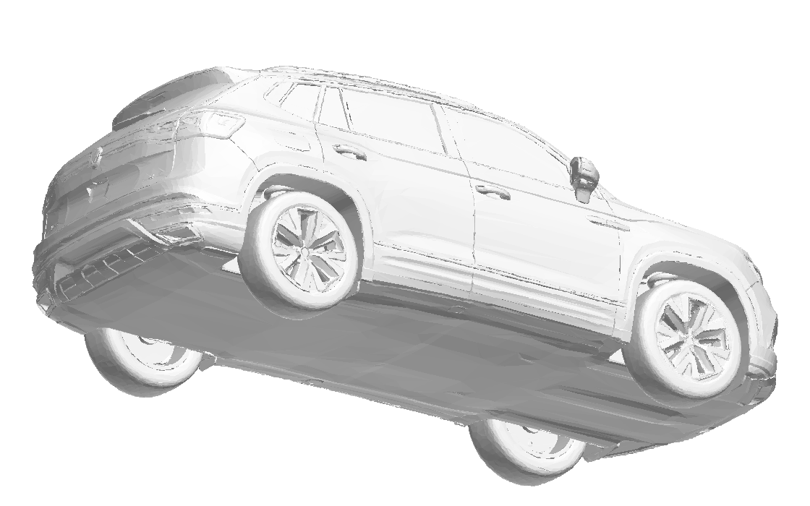
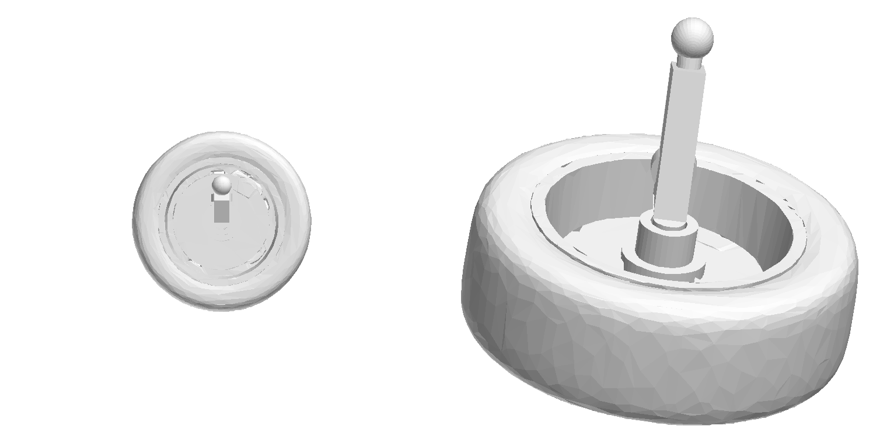

# VW Tayron — модель с подвеской под печать на PLA

Кузов Tayron + независимая подвеска на 4 колеса, целиком печатаемая на FDM из PLA:
прямой рычаг на шаровом шарнире, отдельная витая пружина и ступичная пробка.

**Колёса — исходные, без единого реза.** В дисках нет ни одного отверстия:
крепление входит в *родное* коническое углубление ступицы и приклеивается изнутри,
снаружи диск выглядит ровно как в исходной модели. ТЗ, по которому это сделано
(и по которому можно повторить), лежит в [`DESIGN.md`](DESIGN.md).



Слева — внешняя сторона колеса: **диск целый, отверстий нет**. Справа — колесо изнутри:
в его родном углублении стоит ступичная пробка, на которую надевается рычаг.



## Что в репозитории

| Файл | Что это |
|---|---|
| `Tayron3_suspension.3mf` | Печатная сборка, **17 объектов**: кузов с пазами + 4 рычага + 4 колеса + 4 ступичные пробки + 4 пружины |
| `run.py` | Запуск сайта: сам находит свободный порт и открывает страницу |
| `suspension/` | Сайт с интерактивной демонстрацией (нагрузка в граммах, ход в мм, сборка/разборка) |
| `DESIGN.md` | ТЗ/промпт: ограничения PLA, формулы, критерии приёмки |
| `Модель №2 Tayron.3mf` | Исходная модель (кузов + колёса) |
| `Single_color.3mf` | Исходный проект пользователя (детали 217, 224 и др.) |
| `reference/` | Фотографии машины |

## Печать в 150 мм (масштаб 17 %)

Файл остаётся в исходных единицах (кузов 882 ед.), печатать **уменьшенным до 150 мм
по длине** — в слайсере 17 %. Все размеры механизма подобраны под этот масштаб,
в правой колонке — то, что получится на столе:

| Деталь | В файле | Напечатается |
|---|---|---|
| Рычаг — тело | 11.8 × 17.6 ед. | **2.0 × 3.0 мм**, длина 14.4 мм |
| Рычаг — шаровой конец | Ø15.3 ед. | шар **Ø2.6 мм** на шейке Ø1.5 × 2.2 мм |
| Рычаг — цапфа под ступицу | Ø11.8 × 9.4 ед. | **Ø2.0 × 1.6 мм** |
| Гнездо шара в кузове | Ø21 ед. | Ø3.6 мм (зазор 0.5 мм, **на клей**) |
| Ступичная пробка | Ø30.6 × 25.3 ед. | фланец **Ø5.2 × 0.9**, шпигот Ø3.0 × 1.2, бобышка Ø3.6 × 2.2, гнездо Ø2.3 × 2.0 |
| Пружина | провод Ø7.1, Ø34 ед. | провод **Ø1.2 мм, наружный Ø5.8, длина 13 мм, 5 витков** |
| Зазоры в подвижных парах | 0.3–2.5 ед. | **0.05–0.43 мм** |
| Ход подвески | 12 ед. | **2.0 мм** |
| Масса модели | — | ≈370 г при 100 % заполнении, ≈80 г при 20 % |

Что важно знать про этот масштаб:

* **Диски не сверлятся.** Колесо крепится ступичной пробкой: её фланец ложится на
  кольцевую площадку ступицы, шпигот Ø3.0 входит в родное углубление (Ø5.7 → Ø1.4,
  глубина 2.6 мм), всё на клей. Пробка целиком спрятана в полости колеса —
  снаружи не видно ничего.
* **Защёлку шарнира печатать бессмысленно** — губка вышла бы 0.3 мм. Поэтому шар
  Ø2.6 вставляется в сферическое гнездо Ø3.6 и **приклеивается**: гнездо держит его
  от сдвига и проворота, клей — от выпадения. Нужен именно механический замок —
  увеличьте шар до Ø4 мм (губка 0.4 мм), тогда он щёлкает.
* Ход 2 мм на глаз почти не видно. Печатайте крупнее — крепления масштабируются
  вместе с файлом: 30 см ⇒ ход 4 мм, 45 см ⇒ 6 мм.

## Как устроено

1. **Рычаг** — прямая деталь 2.0 × 3.0 мм в вертикальной плоскости колеса (x = const),
   плечо 85 ед. (14.4 мм). **Один и тот же файл печатается 4 раза** — деталь
   симметрична, у всех колёс одинаковое крепление, ничего не «стоит косо».
2. **Крепление рычага к кузову** — шаровой шарнир: на конце рычага шар Ø2.6 на шейке
   Ø1.5, в кузове вырезано сферическое гнездо Ø3.6 с раструбом. Шар сидит внутри
   кузова и качается на всём ходе; **рычаг держится за кузов**, а не «вставлен
   в прорезь».
3. **Колесо** — на ступичной пробке (см. выше). Пробка надевается на цапфу рычага
   Ø2.0 × 1.6 мм, колесо — на пробку. Цепочка «кузов → шар → рычаг → цапфа →
   пробка → колесо» жёсткая, консольных деталей нет.
4. **Пружина** — печатная витая: провод Ø1.2, наружный Ø5.8, 5 витков,
   свободная длина 13 мм. Стоит вертикально между площадкой рычага и карманом
   в кузове. Жёсткость:
   `k = G·d⁴/(8·D³·n) = 1200·2.07 / (8·4.6³·5) ≈ 0.64 Н/мм` на пружине,
   `0.64 · 0.565² ≈ 0.20 Н/мм` на колесе.

### Как печатать пружину (важно)

Ставить **стоя, осью вертикально**, слой 0.12–0.2 мм, **поддержки не нужны**:
витая пружина режется слоями как спиральный пандус — каждый следующий слой
лежит на предыдущем со сдвигом 0.24 мм, а промежутки между витками (1.2 мм)
остаются пустыми. Поддержки понадобятся только если печатать её лёжа.

### Сборка

1. Кузов, 4 рычага, 4 колеса, 4 пробки, 4 пружины — PLA, 3 периметра, 15–20 %.
2. Шар рычага — в гнездо кузова (со стороны арки), капля клея.
3. Пробку — шпиготом в углубление ступицы, фланец на площадку колеса, клей.
4. Колесо с пробкой — гнездом пробки на цапфу рычага, клей.
5. Пружину — на площадку рычага, верх в карман кузова.

Колесо после сборки не крутится (оно на клею) — это модель для полки, а не машинка.
Если нужны крутящиеся колёса, скажите: понадобится либо сквозное отверстие в диске,
либо вилка, охватывающая колесо снаружи, — оба варианта меняют внешний вид диска.

## Замеры сборки (не на глаз)

Все числа — в миллиметрах **печати** (17 %), расстояние между поверхностями,
посчитанное по триангуляции (`closest_point`), а не «на глаз по картинке»:

| Стык | Зазор |
|---|---|
| рычаг ↔ кузов на рабочем ходе ±3° | **0.05–0.43 мм** по четырём углам |
| рычаг ↔ колесо | 1.80 мм |
| ступичная пробка ↔ колесо | 0.10 мм (посадка под клей) |
| ступичная пробка ↔ цапфа рычага | 0.14 мм (посадка под клей) |
| пружина ↔ площадка рычага | 0.30 мм (слева) / 0.00 (справа — лежит на площадке) |
| пружина ↔ карман кузова | 0.16 мм (слева) / 0.01 (справа) |

Все тела (кузов, 4 колеса, 4 рычага, 4 пробки, 4 пружины) watertight; в 3MF нет
вырожденных треугольников. Пружина весит ≈0.07 г PLA, пробка ≈0.05 г, рычаг ≈0.09 г.

## Сайт

```bash
python3 run.py               # сам найдёт свободный порт и откроет браузер
python3 run.py --port 8080 --no-browser
```

**Анимация сборки.** Кнопка «Разобрать» (или ползунок 0–100 %) разносит машину
на детали в порядке разборки: сначала сходят колёса, за ними ступичные пробки,
потом рычаг выходит из гнезда вдоль своей оси, последней поднимается пружина.
Сборка идёт в обратном порядке, физика на время разборки замораживается.

**Как в игровом движке.** Сайт не считает статическую формулу — он крутит
твёрдое тело с гравитацией: кузов на четырёх пружинах с демпфером
(3 степени свободы: просадка, крен, тангаж), шаг интегрирования 1/720 с.
Поэтому кузов **качается и успокаивается**, а не телепортируется в новое
положение. Кнопка «Тряхнуть» даёт вертикальный импульс, ползунки «Масса»
и «Демпфер» меняют инерцию и затухание.

Жёсткость в демонстрации задаётся ползунком «на колесе»; у напечатанной
пружины она 0.2 Н/мм, поэтому реальная модель (≈80 г) проседает на ≈1 мм —
половину хода. Демонстрационные массы (до 3 кг) нужны только для того, чтобы
колебания были видны.

## Как ведёт себя (демонстрация: k = 0.7 Н/мм на колесо, масса 1.5 кг, ζ = 0.22)

| Нагрузка | Крен | Тангаж | Просадка | Пик просадки | Ход ПЛ / ПП / ЗЛ / ЗП |
|---|---|---|---|---|---|
| 0.5 кг на ПЛ | 0.65° | 0.38° | 1.8 мм | 2.1 мм | +4 / +1 / +1 / −2 мм |
| 1.5 кг на крышу | 0° | 0° | 5.3 мм | 6.3 мм | 5 / 5 / 5 / 5 мм |
| 0.8 кг в багажник | 0° | 0.61° на корму | 2.8 мм | 3.4 мм | 0 / 0 / 5 / 5 мм |
| 1.6 кг на левый борт | 1.26° | 0° | 3.4 мм | 3.6 мм | +7 / −3 / +7 / −3 мм |
| 3 кг ровно | 0° | 0° | 6.8 мм | 7.1 мм | 7 / 7 / 7 / 7 мм |

## Что стало с деталями 217 и 224

В механизме их больше нет. Балка 217 — это ось, она входила в ступицу только
через **сквозное отверстие в диске**, а втулка 224 — подшипник в этом отверстии.
Раз диск сверлить нельзя, сквозной оси некуда идти, поэтому её роль выполняет
ступичная пробка, входящая в родное углубление колеса. Сами детали остались
в исходном `Single_color.3mf` — если понадобится вариант с крутящимся колесом,
они вернутся вместе с отверстием.
