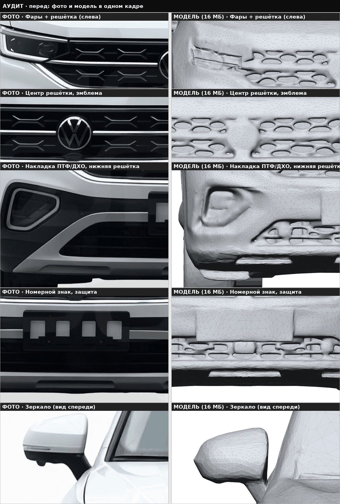
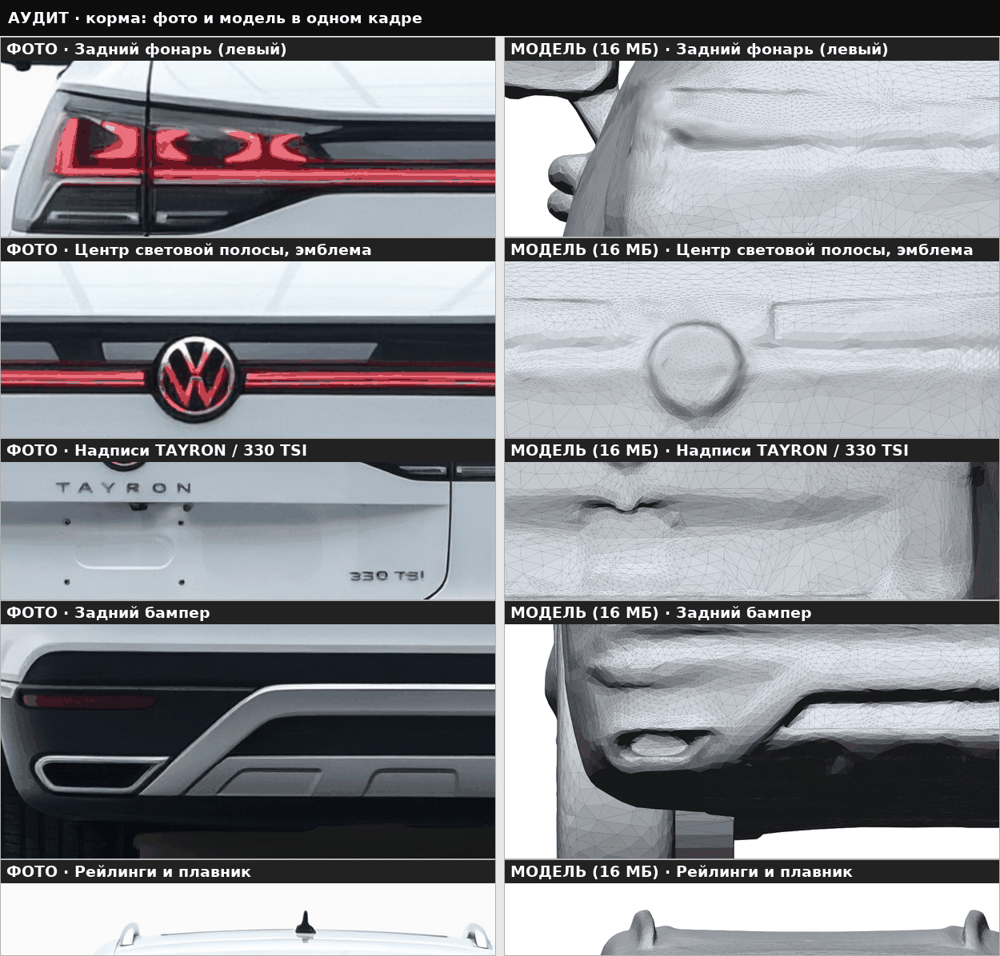
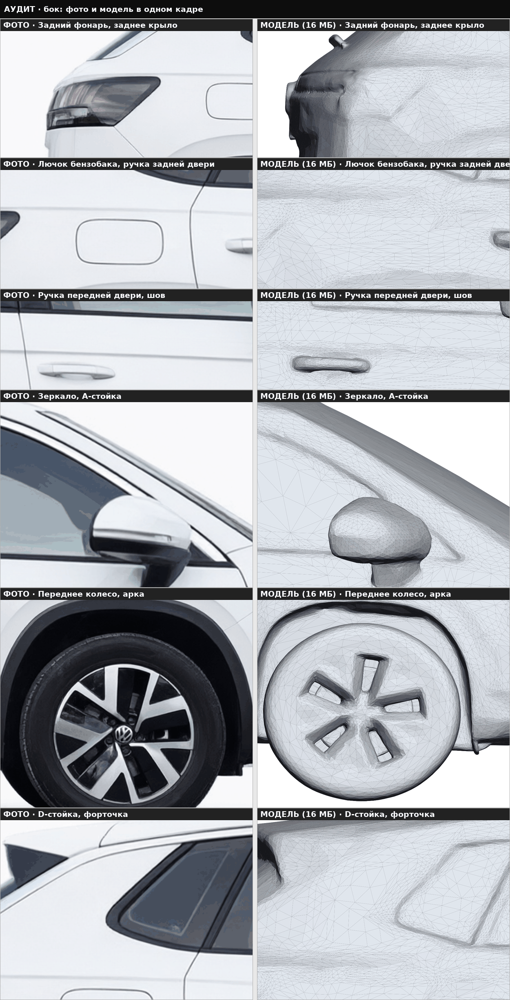

# Аудит: модель Tayron 2023 vs фотографии

Детальная сверка геометрии `tayron_2023_optimized.stl` (16 МБ, 333 416 граней) и
`tayron_2023_optimized_lite.stl` (5 МБ, 100 000 граней) с тремя референсами из
`reference/`. Сравнение — в одном кадре: каждая пара картинок ниже снята с одного
и того же пиксельного прямоугольника, поэтому любые расхождения — это уже разница
геометрии, а не ракурса.

## Короткий ответ

Нет, «так же чётко» — нет. Модель совпадает с фото по **силуэту и крупным
членениям** (габариты, бамперы, арки, швы дверей, контуры фар и фонарей,
накладки), но **рисунок** мелких элементов — решётка, эмблемы, шильды, узор
фонарей, диски, лючок, обвес — либо грубее в 1.5–2 раза, либо отсутствует как
читаемая форма. Три «полки» качества:

| Уровень | Что попадает |
|---|---|
| Как на фото (в пределах ~1 %) | габарит и силуэт по трём видам, линия крыши и стёкол, оба бампера целиком, арки и колёсные ниши, швы дверей и капота, ручки (как объекты), рейлинги, спойлер, накладки ПТФ, номерные площадки, салон (виден через стекло) |
| Читается, но грубее | контуры фар и фонарей, сота решётки, накладка заднего бампера, площадки шильдов, подштамповка двери и крышки багажника, зеркала |
| Не читается / нет | эмблемы VW (обе), надписи `TAYRON` / `330 TSI` / `一汽-大众`, красный узор фонарей, лючок бензобака, плавник на крыше, дворники, рисунок диска, уступ пластикового обвеса |

## Как сравнивал

* Проекция ортогональная, регистрация — по габаритному прямоугольнику: bbox
  модели по осям кадра совмещается с bbox машины на фото (не-белые пиксели без
  тени и водяного знака). Масштабы: перед `3.4699 / 3.4744` px на юнит
  (совпадение по осям 0.1 % — вид спереди действительно ортогональный), бок
  `2.4326 / 2.1678`, корма `2.805 / 3.161`.
* Анизотропия по боку и корме — свойство самих референсов: на боковом виде
  машина растянута по длине примерно на 12 % (отношение высота/длина у фото
  0.338, у реальной машины 0.362, у модели 0.379), на корме зеркала не попадают
  в силуэт. Поэтому по боку и корме модель подгоняется к фото с этим растяжением
  — так совпадают положение и размеры элементов, но «идеальная» геометрия в
  кадре выглядит слегка сжатой.
* 1 юнит ≈ 4.9 мм; габарит модели 899.9 × 427.1 × 341.4 юнита
  (≈ 4410 × 2093 × 1673 мм вместе с зеркалами).
* Референсы — синтетические рендеры (водяной знак Qwen), поэтому **цвет и
  материал не сравниваются**, только форма. Часть «идеальностей» на фото
  (идеально ровные панели, тонкие зазоры) в CAD-геометрии недостижима в принципе.
* Инструмент: `tools/audit_vs_photo.py` — рисует наложения и листы ниже
  (`python3 tools/audit_vs_photo.py all`).

## Передняя часть

| Элемент | На фото | В модели | Вердикт |
|---|---|---|---|
| Соты решётки | шаг ≈ 10 юнитов (≈ 50 мм), тонкие перемычки | шаг ≈ 18 юнитов (≈ 88 мм) — **в 1.8 раза крупнее**, отверстия овальные и разной формы | упрощено, самое заметное на «лице» |
| Хром-перекладины решётки | две тонкие, чётко отделены от соты | толстые валики, сливаются с полем сот | упрощено |
| Эмблема VW спереди | круглый хром-знак с читаемыми буквами, Ø ≈ 150 мм | пологий купол того же Ø, **без обода и без букв** | отсутствует как рисунок |
| Фара | L-образная бровь, тёмный корпус, круглый проектор, LED-линия по низу, вертикальный разделитель | внешний контур и бровь совпадают с фото; внутри 2–3 продольных валика, проектора и разделителя нет | контур — да, начинка — нет |
| Накладка ПТФ/ДХО | трапеция с ярким кантом, утоплена в бампер | есть, кант мягкий, вокруг бампера «пузырится» | упрощено |
| Нижняя решётка, номер | горизонтальные ламели; рамка номера с 4 отверстиями | соты вместо ламелей; рамка — просто бобышка без отверстий | упрощено |
| Серебристая «защита» | плавная дуга с уступом | есть, но с волнами | мелкие недочёты |
| Зеркало | компактный корпус, хром-полоса повторителя | «камень» в 1.5–2 раза толще, без повторителя, толстая нога | заметное упрощение |
| Кромка капота, дворники | ровный шов, две щётки | шов есть, но у кромки волны; дворников нет — только волнистый валик | мелкие недочёты |

## Корма

| Элемент | На фото | В модели | Вердикт |
|---|---|---|---|
| Световая полоса | красная полоса, в блоках рисунок «стрелок», сверху хром-накладка, чёткие границы | полоса-пластина с парой валиков и уступом справа; рисунок стрелок читается только как намёк | упрощено (сильнее всего) |
| Эмблема VW сзади | хром-круг Ø ≈ 150 мм с буквами | **тор** (кольцо) без букв и без заполнения | отсутствует как рисунок |
| Надписи `TAYRON`, `330 TSI`, `一汽-大众` | читаемые буквы с разрядкой | рельефные площадки; буквы как формы не читаются | отсутствует |
| Подштамповка крышки | тонкая линия под надписью | грубый волнообразный вал с «переломом» в центре | грубее и заметно волнистая |
| Датчики парковки | 4 аккуратных точки | бугорки-бобышки | мелкие недочёты |
| Задний бампер | матовый чёрный, серебристая #-накладка, отражатели, угловые накладки | всё на месте, поверхности волнистые, накладка грубее | упрощено |
| Рейлинги | серебристые, тонкие, с ножками | есть, но толще и короче | мелкие недочёты |
| Плавник на крыше | чёрный «плавник» | **отсутствует**: по осевой линии крыши максимум 156.6 юнита и плавного спада, выступа над крышей нет (168.9 — это рейлинги по бортам) | нет |

## Бок

| Элемент | На фото | В модели | Вердикт |
|---|---|---|---|
| Задний фонарь | крупный блок с красным узором и чётким кантом, заходит на крыло | тёмная зона с намёками-«F» на углу, канта нет | упрощено (сильно) |
| Лючок бензобака | скруглённый прямоугольник ≈ 150 × 100 мм с зазором | **отсутствует** — гладкая панель | нет (дёшево сделать) |
| Ручки дверей | тонкая хром-скоба в углублении | толстая «подушка» без углубления, ниже на ~30 мм | упрощено |
| Подштамповка борта | мягкая тонкая линия | линия есть, но грубее и ниже | мелкие недочёты |
| Швы дверей | тонкие ровные | есть, волнистые | мелкие недочёты |
| Обвес арок и порога | чёрный пластик с уступом 10–15 мм | уступа нет, только мягкая канавка | упрощено (влияет на «внедорожный» вид) |
| Диски | 5 сдвоенных спиц, двухцветные; диск ≈ 72 % диаметра колеса | 5 одиночных спиц, диск ≈ 85–90 % диаметра — шина слишком низкопрофильная и гладкая | упрощено (заметно) |
| Зеркало, A-стойка | плоская наружная панель, кант, повторитель | «булыжник» без канта | заметное упрощение |
| D-стойка, форточка | трапеция с острым углом + чёрная накладка D-стойки | скруглённый прямоугольник, крупнее и выше, накладки нет | упрощено |
| Плавник, рейлинги | см. выше | плавника нет | нет |

## Что в модели безусловно хорошо

* Силуэт по трём видам совпадает с фото на ~1 % — это результат регистрации,
  а не подгонки: габариты и пропорции модели ближе к реальному автомобилю, чем
  сами референсы (они растянуты).
* Все крупные элементы присутствуют и стоят на своих местах: оба бампера с
  накладками, арки и ниши, стёкла и рейлинги, спойлер, швы дверей/капота,
  ручки, зеркала, диски, номерные площадки.
* Модель `watertight`, одна деталь, объём совпадает с исходником до 0.002 %.
* Внутри есть салон (сиденья, руль) — виден через стекло, этого на фото не
  проверить, но добавляет «жизни» рендерам.

## Почему так вышло (систематика, а не случайности)

1. **Рельеф наносится «протравливанием» по фото с шагом сетки.** Отсюда шаг
   соты 18 юнитов вместо 10, «валики» вместо рисунка фонаря и площадки вместо
   букв: элемент мельче шага сетки не воспроизводится.
2. **Мелкие элементы не были в исходной геометрии** (эмблемы как рисунок,
   буквы, лючок, плавник, дворники, уступ обвеса). Их нельзя «проявить» — их
   нужно строить.
3. **Плоские панели дрожат.** Бампер, капот и крышка багажника дают волны
   амплитудой ~1–2 юнита (5–10 мм). Это следствие шага сетки на плоскостях
   (1.0–1.3 юнита) и нескольких проходов сглаживания, а не формы кузова.
4. **Децимация до 5 МБ не добавила новых дефектов**, но «съела» запас: рисунок
   фонаря и соты на 100 000 гранях читаются хуже, канты становятся шире.

## Приоритетный план правок

Порядок — по отношению «заметность / стоимость». Оценка — прирост граней к
текущим 333 416.

**A. Дёшево и заметно (+15–25 тысяч граней суммарно)**

1. Лючок бензобака: замкнутая канавка 1.2 × 0.8 юнита по контуру 32 × 20 —
   +2 000. Самый выгодный пункт: элемент на виду, сейчас его нет вообще.
2. Плавник на крыше: клин 22 × 7 × 12 со скруглением — +400.
3. Уступ обвеса: полоса по аркам и порогу сдвигается по нормали на 1.8 юнита,
   край — фаска 0.6 — +8 000–12 000. Сразу «собирает» внедорожный силуэт.
4. Кант заднего фонаря: замкнутая канавка по контуру (крыло + крышка) — +4 000.
5. Дворники: два бруска 3 × 55 × 1.5 у кромки лобового — +600.
6. Отражатели и угловые накладки заднего бампера — сделать канавками, +2 000.

**B. Средне (+30–50 тысяч)**

7. Диски: 5 сдвоенных спиц вместо 5 одиночных, граница диска/шины
   с 87 % на 72 % диаметра, боковина шины с лёгким бочком — +12 000–18 000.
8. Зеркала: плоская наружная панель, кант, полоса повторителя, тонкая нога —
   +3 000 (но блок перестраивается вручную).
9. Эмблемы: кольцо + упрощённый `VW` (250–400 граней), спереди и сзади — +800
   каждая; на 3D-печати читаются с 300 мм.
10. Рисунок фонарей: 2–3 канавки-«стрелки» в блоках — +3 000.
11. Сота решётки: шаг с 18 до 9–10 юнитов в зоне 300 × 45 — +25 000–40 000
    (это почти всё, что можно позволить в 16-МБ сборке).

**C. Дорого / спорно**

12. Читаемые шильды `TAYRON`, `330 TSI`: шаг букв ~1.2 юнита, это +10 000–20 000
    на надпись, и на печати всё равно будет «грязно» — реалистично только для
    рендера.
13. Идеально ровные панели: нужен отдельный проход сглаживания по зонам малой
    кривизны (или местное уплотнение плоскостей), иначе волны останутся.
14. Узор фонаря «как на фото» целиком (красный рисунок) — требует ручной
    прорисовки по контуру с фото; автоматически не получается.

## Файлы

* `audit_front.png`, `audit_rear.png`, `audit_side.png` — листы «фото | модель»
  по зонам, кадры совпадают пиксель в пиксель.
* `audit_overlay.png` — силуэт и рёбра перегиба модели поверх фото (проверка
  регистрации; сквозь полупрозрачность видна и обратная сторона кузова).
* `tools/audit_vs_photo.py` — воспроизводит все четыре картинки:
  `python3 tools/audit_vs_photo.py all`, для lite —
  `python3 tools/audit_vs_photo.py sheets --model tayron_2023_optimized_lite.stl --tag "5 МБ"`.
